# Boundless 기능별 화면 안내 (심사용)

한국에 사는 외국인이 모국어로 묻고, 다른 나라 이웃의 경험으로 답을 얻는 익명 커뮤니티입니다. 이 문서는 심사에서 볼 핵심 기능을 화면 단위로 나눠 정리했습니다. 캡처마다 무엇을 보면 되는지 적었고, 빨간 테두리는 그 화면에서 봐야 할 기능입니다.

- 캡처 환경: 2026년 11월 17일, 로컬 개발 서버, 새로 만든 샘플 데이터(모두 가상 인물·가상 글), 화면 언어 한국어, 데스크톱 1440px · 휴대폰 390px
- 샘플 데이터: 나라별 샘플 글에 더해, 가상 주민 45명이 일주일 동안 자기 언어로 글을 쓰고 답하고 "도움돼요"를 누른 시뮬레이션 기록이 들어 있습니다(아래 "AI가 쓰이는 곳" 참고).
- AI 기능 캡처는 미리 꾸민 결과가 아니라 NVIDIA NIM을 실제로 호출해 나온 결과입니다. AI 비자 태그(4-3), 위기 상담 카드(4-6), AI 질문 점검(5-3) 세 장은 11월 12일 캡처를 그대로 썼습니다. 그래서 디자인 개편 전 화면이고, 기능과 동작은 지금과 같습니다.
- 직접 보기: https://boundless-virid.vercel.app → 소개 페이지의 "심사위원 · 체험용 샘플 계정"에서 나라를 고르면 이메일 인증 없이 들어가고, 체험 가이드가 순서대로 안내합니다.

## 한눈에 보기

| # | 화면 | 핵심 기능 | 경로 |
| --- | --- | --- | --- |
| 1~3 | 소개 페이지 | 서비스 소개, 나라별 문화 장면 16개, 심사용 샘플 계정 | `/` |
| 4~5 | 로그인 | 나라를 고르면 화면 전체가 그 나라 장면과 모국어로 바뀜 | `/login` |
| 6 | 가입 직후 | 아바타 만들기 첫 단계 (건너뛰기 가능) | `/settings/avatar?welcome=1` |
| 7~8 | 체험 가이드 | 심사용 계정에만 나오는 11단계 스포트라이트 안내 | 샘플 계정으로 입장 |
| 9~10 | 홈 피드 | 모국어 인사, 나라별 라운지, 모두의 광장, 16개 화면 언어 | `/feed` |
| 11~12 | 게시판 · 라운지 | 게시판 12개, 같은 국적만 들어오는 라운지 | `/boards`, `/lounge` |
| 13~14 | 검색 | 원문·번역문 검색, 결과가 없으면 바로 질문 | `/search` |
| 15 | 알림 | 내 글과 답변에 달린 반응을 한곳에 | `/notifications` |
| 16~21 | 글 상세 | 공식 기관 연결, 번역, AI 비자 태그, 채택 답변, AI 해결 요약, 위기 상담 카드 | `/posts/[id]` |
| 22~25 | 글쓰기 | 게시판 고르기, 비슷한 글 안내, 개인정보 경고, AI 질문 점검, 장터 입력 칸 | `/write` |
| 26~30 | 프로필 · 아바타 · 내 글 | 프로필 카드, 사람·동물 아바타, 사진으로 색 맞추기, 레벨 | `/settings`, `/settings/avatar`, `/me` |
| 31~33 | 안전 · 운영 | 공식 안내(긴급 전화), 신고·차단, 운영 큐 | `/guide`, `/report`, `/admin` |
| 34~36 | 휴대폰 | 하단 탭, 긴급 번호 바로가기, 휴대폰 글 화면과 가이드 | 같은 경로 |

---

## 1. 첫 화면과 가입

### 1-1. 소개 페이지

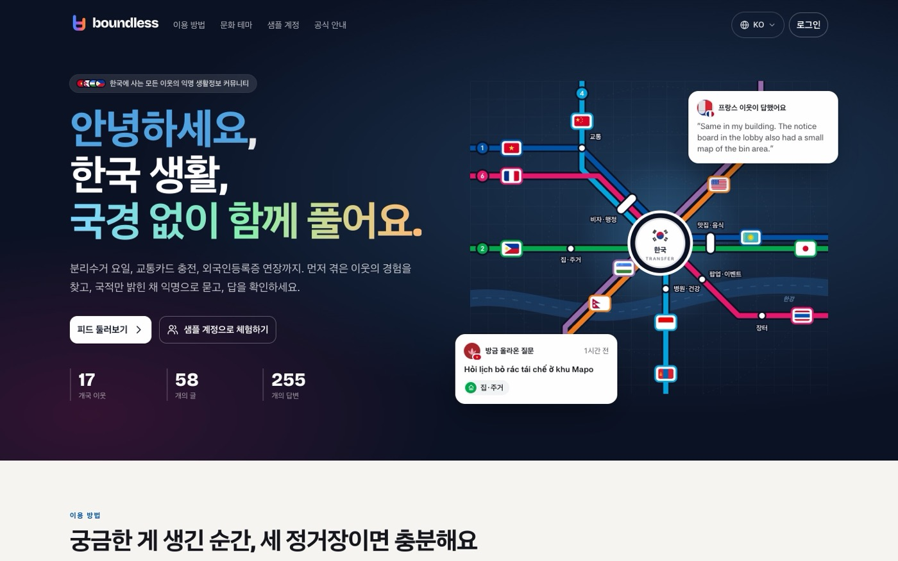

- 서울 지하철 노선도를 모티프로 한 첫 화면입니다. 여러 나라(국기 역)의 노선이 한국에서 만나고, 생활 주제(교통, 비자, 집, 병원 등)가 역으로 이어집니다.
- 인사말이 여러 나라 말로 바뀌고, 노선도 위에는 실제 최신 글과 답변이 카드로 떠 있습니다.
- 아래 숫자는 지금 DB에 있는 나라 수, 글 수, 답변 수입니다.

### 1-2. 나라별 문화 장면 16개

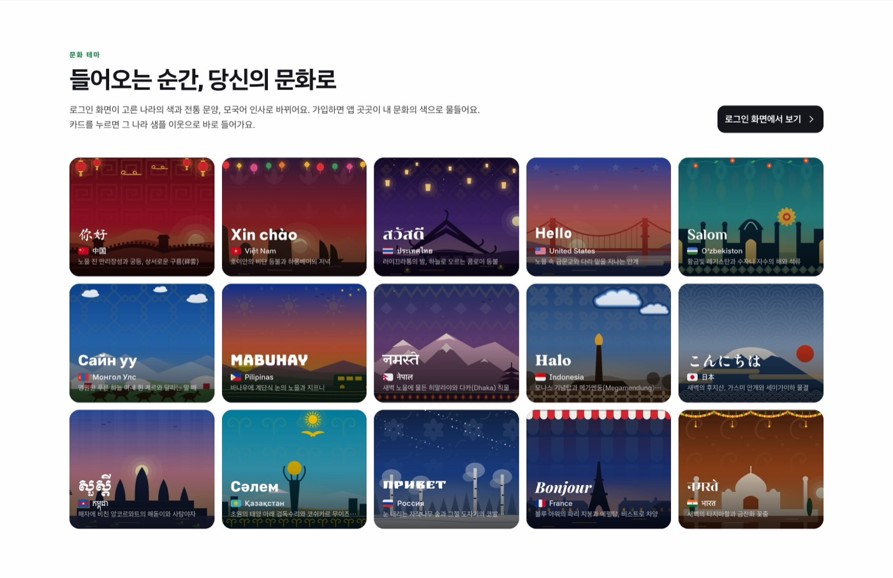

- 나라마다 그 나라 사람이 떠올릴 시간대의 하늘, 랜드마크, 상징 소품이 겹겹이 놓인 장면을 직접 그렸습니다. 베트남은 하롱베이의 저녁과 호이안 비단 등불, 태국은 러이끄라통 밤의 콤로이 등불, 인도네시아는 모나스 기념탑과 메가멘둥 구름 바틱, 인도는 새벽의 타지마할과 금잔화 꽃줄입니다.
- 같은 장면이 로그인 화면, 홈 인사 카드, 라운지, 글쓰기 화면에 이어집니다. 카드를 누르면 그 나라 샘플 이웃으로 바로 들어갑니다.
- 종교·정치 논란이 있는 상징(욱일 문양, 크메르루주를 연상시키는 색, 필리핀 파롤, 네팔 기도 깃발 등)은 조사해서 뺐습니다.

### 1-3. 심사위원 · 체험용 샘플 계정

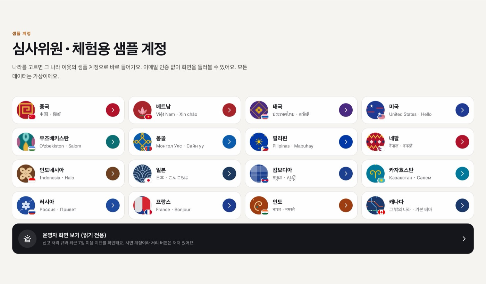

- 나라를 누르면 그 나라 이웃의 샘플 계정으로 바로 들어갑니다. 이메일 인증이 필요 없습니다.
- 맨 아래 "운영자 화면 보기"는 운영 큐를 읽기 전용으로 엽니다(33번 화면).
- 샘플 계정은 모두 `@example.com` 가상 계정이고, 운영 권한은 없습니다. 들어오면 체험 가이드가 시작됩니다(2장).

### 1-4. 나라를 고르면 바뀌는 로그인 화면

| 베트남을 고른 화면 | 일본을 고른 화면 |
| --- | --- |
| 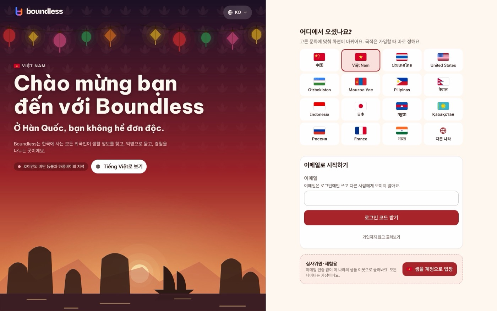 | 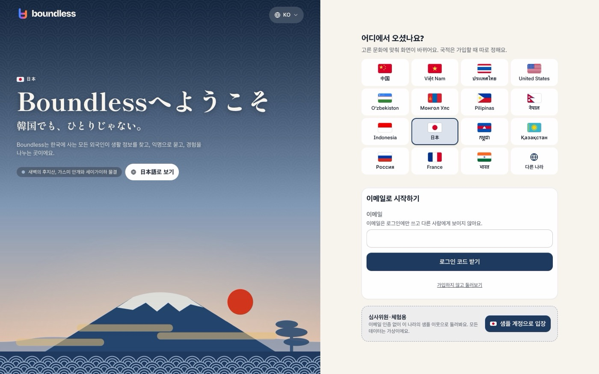 |

- "어디에서 오셨나요?"에서 나라를 누르는 순간, 왼쪽 화면이 그 나라 장면으로 바뀝니다. 모국어 인사와 서체, 버튼 색도 함께 바뀌고, "Tiếng Việt로 보기"를 누르면 화면 언어도 그 나라 말이 됩니다.
- 베트남은 해 질 녘 하롱베이와 비단 등불, 일본은 새벽의 후지산과 가스미 안개, 세이가이하 물결입니다.
- 로그인은 이메일 6자리 코드 방식입니다. 비밀번호를 저장하지 않습니다.

### 1-5. 가입 직후: 아바타 만들기 단계

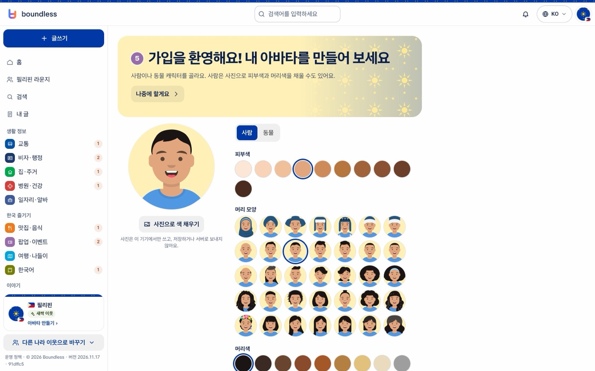

- 가입을 마치면 "가입을 환영해요! 내 아바타를 만들어 보세요" 단계가 먼저 나옵니다.
- "나중에 할게요"를 누르면 바로 원래 가려던 화면으로 갑니다. 강제하지 않습니다.
- 성별이나 나이는 묻지 않습니다. 고르는 것은 생김새뿐입니다.

---

## 2. 체험 가이드 (심사용 샘플 계정 전용)

### 2-1. 첫 카드: 무엇을 하는 곳인지 한 줄로

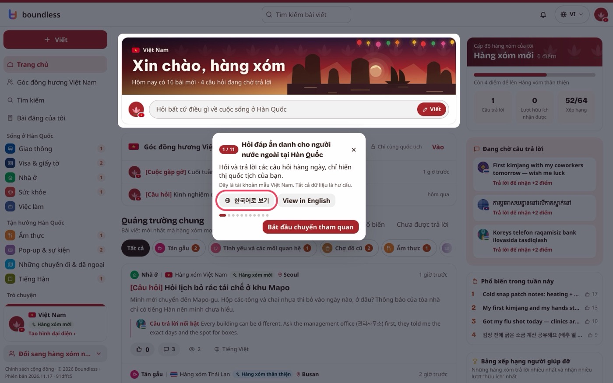

- 샘플 계정으로 들어오면 가이드가 바로 시작됩니다. 첫 카드는 "한국 사는 외국인의 익명 Q&A"라는 한 줄로 서비스가 무엇인지 알려 줍니다.
- 샘플 계정은 그 나라 말로 열립니다(캡처는 베트남 계정). 그래서 첫 카드에 **한국어로 보기 / View in English** 버튼을 두었습니다(빨간 테두리). 이 두 버튼은 어느 화면 언어에서든 같은 문구로 보입니다.
- 실제 회원에게는 나오지 않습니다.

### 2-2. 단계마다 기능 하나를 비추고, 버튼이 다음 행동을 알려 줌

| 데스크톱: 5단계 "질문 열어 보기" | 휴대폰: 3단계 "우리나라 라운지" |
| --- | --- |
| 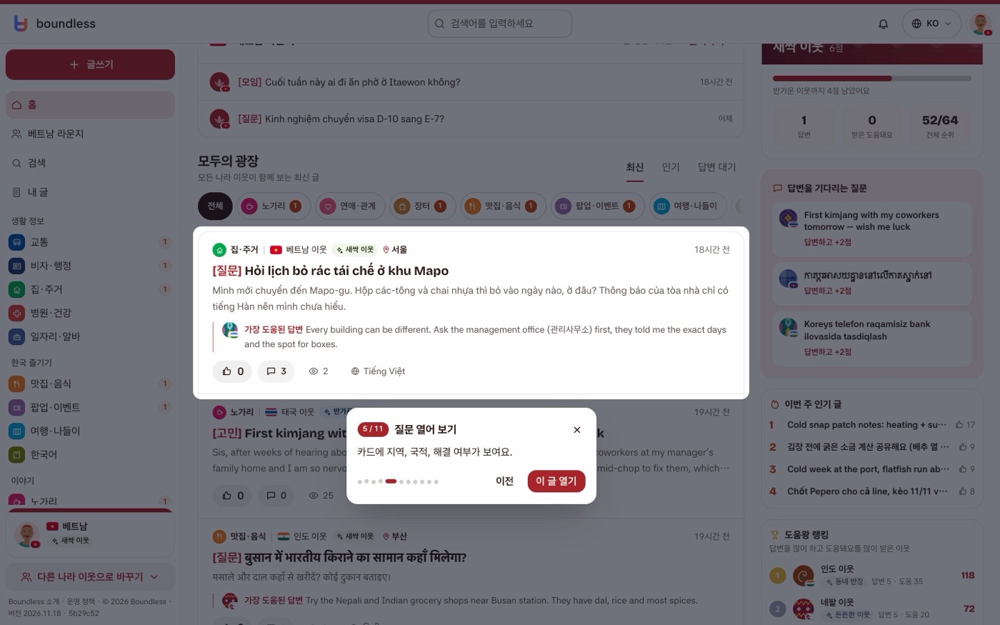 | 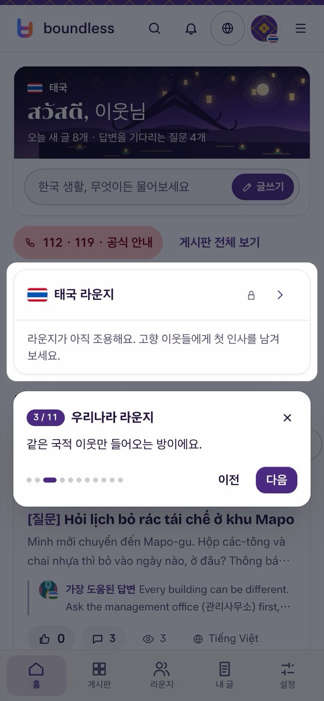 |

- 단계마다 화면의 기능 하나를 밝게 비추고, 제목 한 줄과 설명 한 줄만 보여 줍니다.
- 버튼에는 "다음" 대신 누르면 일어날 일("이 글 열기", "검색 보기", "글쓰기 보기")을 적었습니다. 그 버튼만 누르면 필요한 페이지로 이동합니다.
- 휴대폰에서는 카드가 비춘 곳을 가리지 않도록 위나 아래로 자리를 옮깁니다. Esc나 ×로 닫고, 오른쪽 아래 "체험 가이드" 버튼으로 다시 볼 수 있습니다.

| # | 제목 | 한 줄 설명 |
| --- | --- | --- |
| 1 | 한국 사는 외국인의 익명 Q&A | 생활 질문을 국적만 밝히고 묻고 답하는 곳이에요. |
| 2 | 화면 언어 | 여기서 16개 언어로 바꿔요. |
| 3 | 우리나라 라운지 | 같은 국적 이웃만 들어오는 방이에요. |
| 4 | 모두의 광장 | 모든 나라 이웃의 질문과 경험담이에요. |
| 5 | 질문 열어 보기 | 카드에 지역, 국적, 해결 여부가 보여요. |
| 6 | 원문과 번역 | 모르는 언어도 버튼 하나로 번역해요. |
| 7 | 도움돼요와 저장 | 도움된 글에 고마움을 남기고 저장해요. |
| 8 | 검색 | 답이 없으면 바로 질문으로 이어져요. |
| 9 | 글쓰기 | 게시판을 고르면 작성 안내가 바뀌어요. |
| 10 | 나라 바꾸기 | 다른 나라 이웃이 되면 테마와 언어가 바뀌어요. |
| 11 | 다 봤어요 | 이제 자유롭게 둘러보세요. 운영자 화면은 첫 화면에서 열 수 있어요. |

---

## 3. 홈과 탐색

### 3-1. 홈 피드

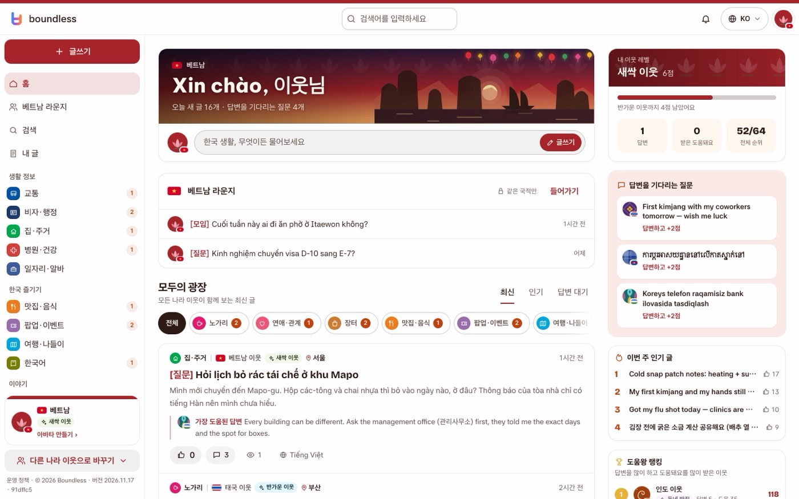

- 맨 위 인사 카드는 내 나라 장면 위에서 내 나라 말로 인사합니다(베트남 계정이면 "Xin chào, 이웃님"). 오늘 새 글 수와 답변을 기다리는 질문 수를 함께 보여 주고, 바로 아래 입력창에서 질문을 시작합니다.
- **베트남 라운지**: 같은 국적만 보고 쓰는 공간의 최신 글입니다.
- **모두의 광장**: 모든 나라가 함께 보는 글입니다. 게시판 칩과 최신·인기·답변 대기 정렬이 있습니다. 답변이 달린 글은 카드에 "가장 도움된 답변"이 미리 보여서, 열지 않아도 답의 방향을 알 수 있습니다.
- 오른쪽에는 내 이웃 레벨과 다음 레벨까지 남은 점수, 답변을 기다리는 질문("답변하고 +2점"), 이번 주 인기 글, 도움왕 랭킹이 있습니다.
- 왼쪽 메뉴에는 게시판별 오늘 새 글 수와 "다른 나라 이웃으로 바꾸기"(심사용)가 있습니다. 글마다 국적, 레벨, 지역, 원문 언어가 보이고, 실명이나 이메일은 어디에도 나오지 않습니다.

### 3-2. 화면 언어 16개

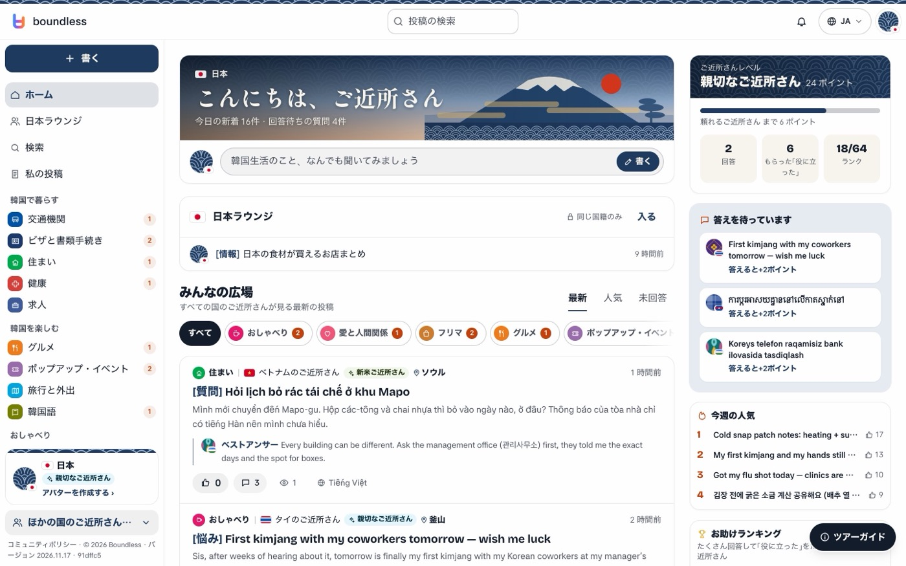

- 같은 홈 화면을 일본 계정으로 본 모습입니다. 메뉴, 버튼, 안내 문구가 모두 일본어이고, 인사 카드는 새벽의 후지산 장면으로 바뀝니다.
- 한국어·영어와 14개국 언어(중국어, 베트남어, 태국어, 우즈베크어, 몽골어, 필리핀어, 네팔어, 인도네시아어, 일본어, 크메르어, 카자흐어, 러시아어, 프랑스어, 힌디어)를 지원합니다.
- 언어를 고른 적 없는 기기에서는 국적 언어가 기본입니다. 오른쪽 위 언어 메뉴에서 언제든 바꿉니다.

### 3-3. 게시판

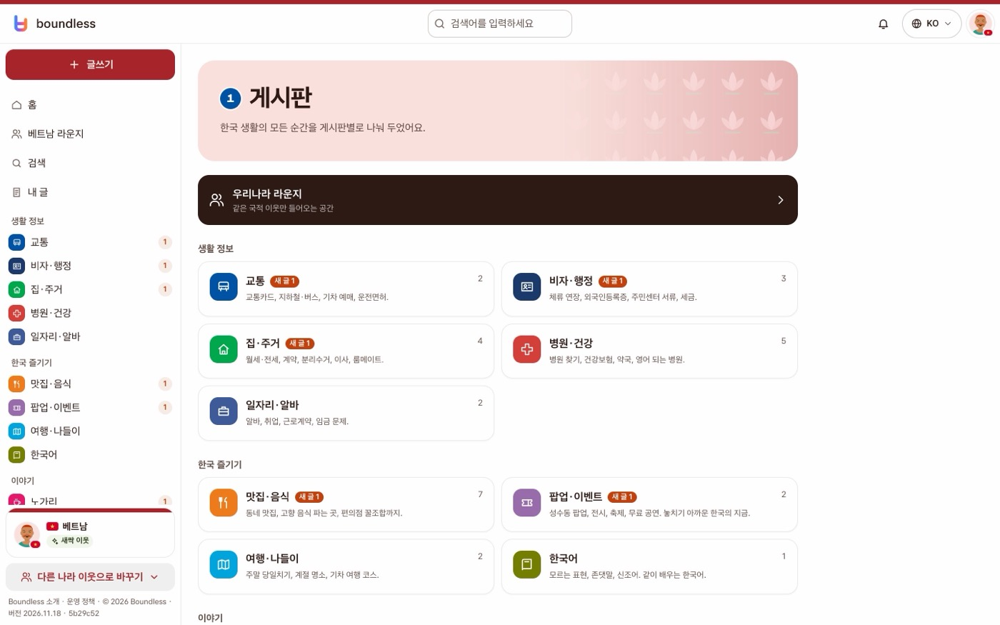

- 생활 정보(교통, 비자·행정, 집·주거, 병원·건강, 일자리·알바), 한국 즐기기(맛집·음식, 팝업·이벤트, 여행·나들이, 한국어), 이야기(노가리, 연애·관계, 장터)로 12개 게시판이 있습니다. 오늘 새 글이 올라온 게시판에는 숫자가 붙습니다.
- 맨 위 "우리나라 라운지"는 같은 국적 전용 공간입니다.
- 페이지 제목 옆의 동그라미 번호는 서울 지하철 노선 배지입니다. 화면마다 다른 노선 색을 써서 지금 어디에 있는지 구분됩니다.

### 3-4. 나라별 라운지

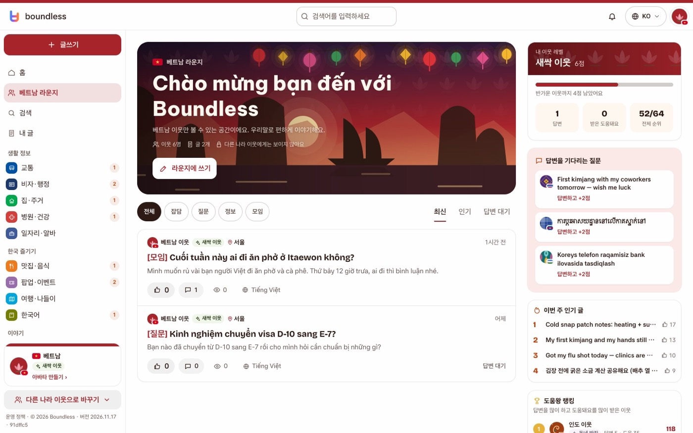

- 같은 국적만 들어오는 공간입니다. 머리에 그 나라 장면이 깔리고, 모국어로 편하게 모임, 잡담, 정보를 나눕니다.
- 다른 나라 사람에게는 이 글들이 보이지 않습니다.

### 3-5. 검색

| 결과가 있을 때 | 결과가 없을 때 |
| --- | --- |
| 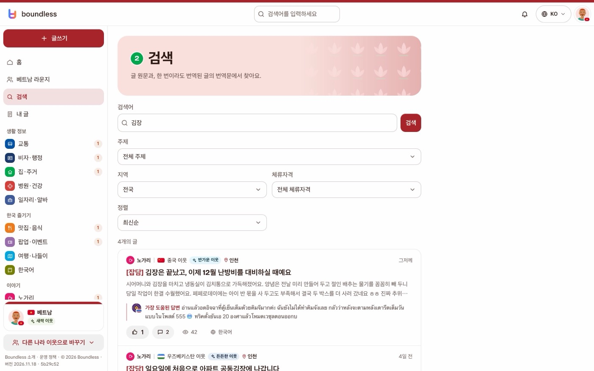 | 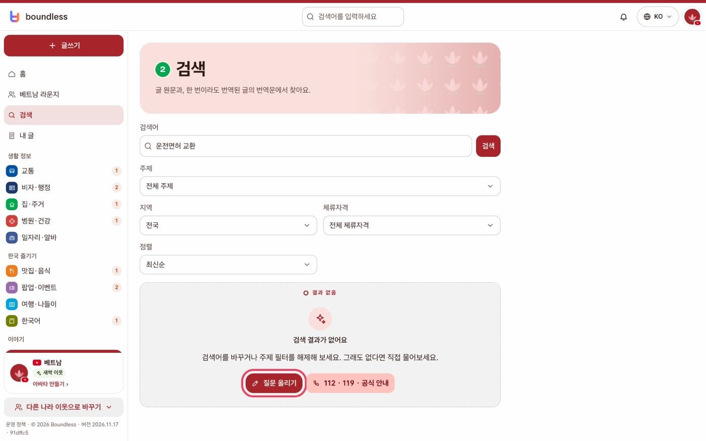 |

- 원문과 번역문을 함께 검색합니다. 주제, 지역, 체류자격, 정렬로 좁힐 수 있습니다.
- 결과가 없으면 "질문 올리기"(빨간 테두리)로 그 검색어를 들고 바로 글쓰기로 갑니다. 급한 사람을 위해 "112 · 119 · 공식 안내" 링크도 함께 나옵니다.

### 3-6. 알림

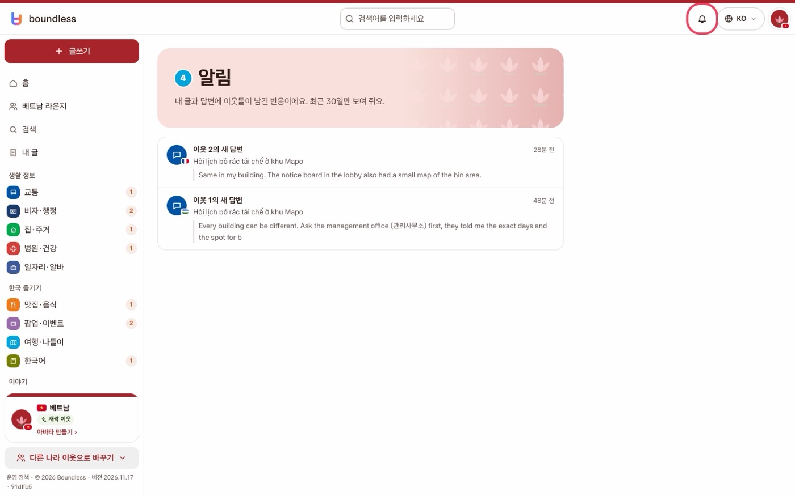

- 위쪽 종(빨간 테두리)에 읽지 않은 알림 수가 붙고, 누르면 알림 화면이 열립니다.
- 내 글과 댓글에 달린 새 답변, 내 글·답변에 눌린 "도움돼요", 내 답변이 채택된 일, 팔로우한 이웃의 새 글을 최근 30일 동안 모아 보여 줍니다. 답변은 내용 일부와 함께 "이웃 2의 새 답변"처럼 익명 호칭으로 보입니다.
- 차단한 사람의 활동은 알림에도 나오지 않습니다.

---

## 4. 글 상세 화면

### 4-1. 글 상세와 공식 기관 연결

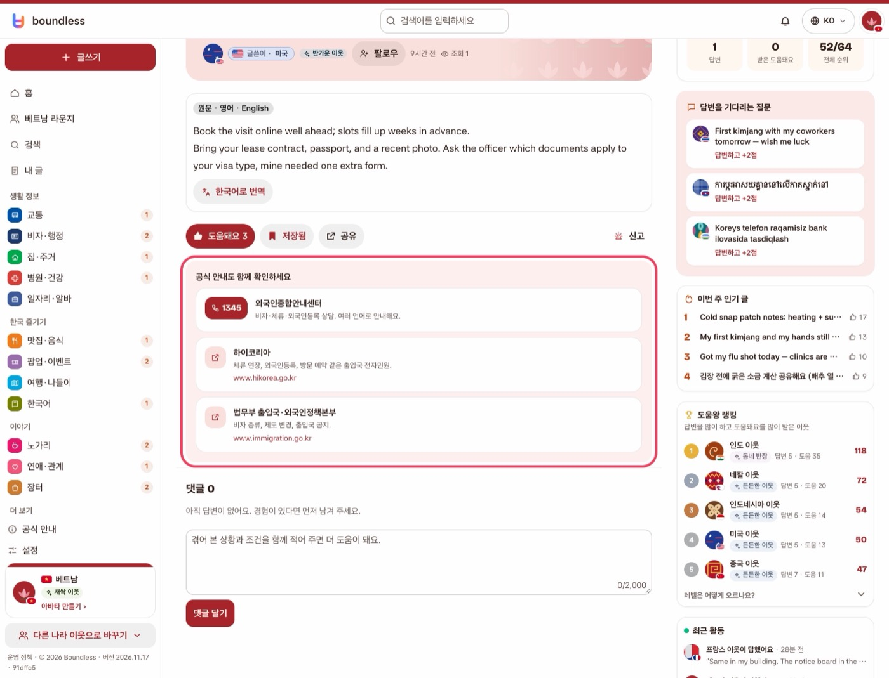

- 글머리에 게시판, 지역, 비자 태그가 있고, 글쓴이는 국적·레벨·익명 호칭으로만 보입니다.
- 본문 아래 **"공식 안내도 함께 확인하세요"**(빨간 테두리): 비자 글이면 외국인종합안내센터(1345), 하이코리아, 법무부 출입국 사이트가 붙습니다. 경험담만으로 끝나지 않게 공식 정보로 보완합니다.
- 도움돼요, 저장, 공유, 신고 버튼이 한 줄에 있습니다. 24시간 동안 답이 없으면 글쓴이가 "도움 요청"으로 글을 목록 맨 위에 다시 올릴 수 있습니다.

### 4-2. 버튼 하나로 번역

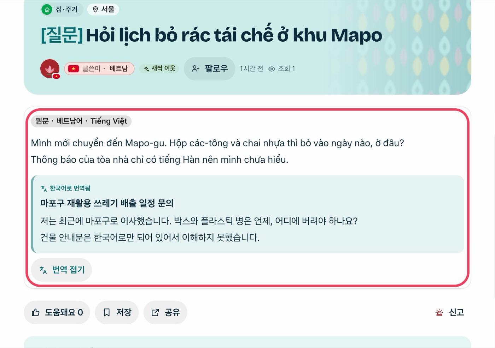

- 베트남어로 쓴 글을 우즈베키스탄 이웃이 한국어 화면에서 본 모습입니다.
- 원문 언어(베트남어)가 표시되고, "한국어로 번역"을 누르면 원문 아래에 번역이 펼쳐집니다(빨간 테두리).
- 번역 결과는 DB에 저장해 다음 사람에게 다시 씁니다.

### 4-3. AI 비자 태그

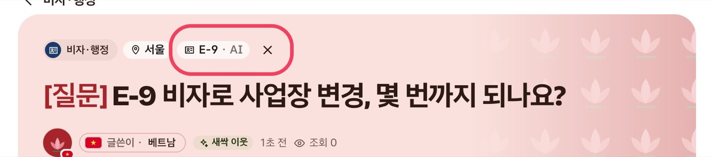

- 글쓴이가 체류자격을 고르지 않았어도, AI가 본문에서 "E-9"을 읽어 **E-9 · AI** 태그를 붙였습니다(빨간 테두리).
- 글쓴이 본인에게만 × 버튼이 보여서, 틀렸으면 바로 지울 수 있습니다.
- 이 태그 덕분에 "E-9" 필터로 검색하면 이 글도 함께 나옵니다.
- 11월 12일 캡처입니다(디자인 개편 전).

### 4-4. 채택된 답변

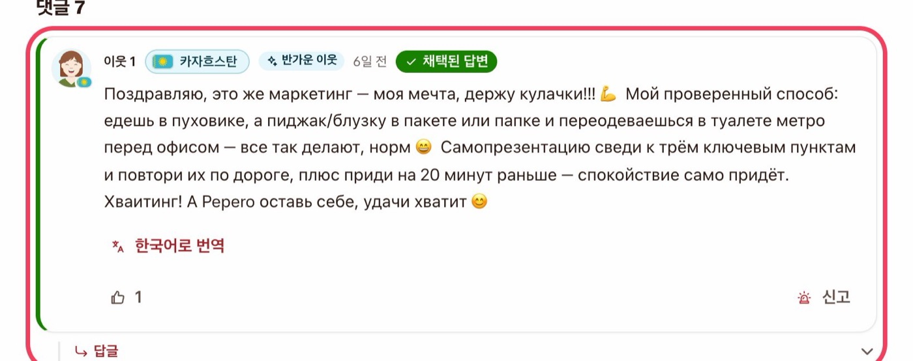

- 질문한 사람이 가장 도움이 된 답변을 "채택"하면 **채택된 답변** 표시가 붙고 맨 위로 올라옵니다. 캡처는 카자흐스탄 이웃이 러시아어로 쓴 답변입니다.
- 해결된 글에는 "15개국 이웃이 함께 해결"처럼 함께 푼 나라가 표시됩니다(35번 화면).

### 4-5. AI 해결 요약

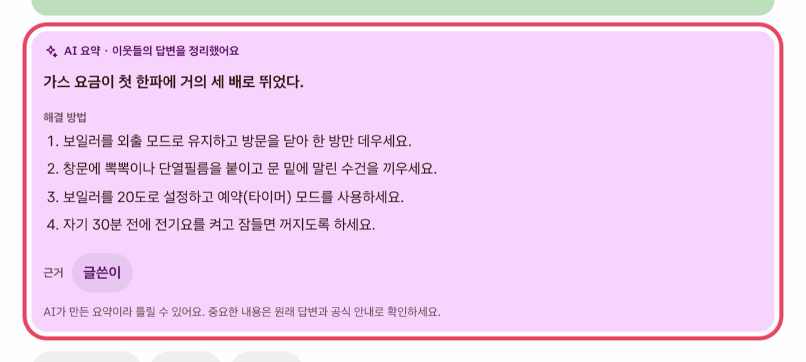

- 해결된 질문에만 나옵니다. 이웃들의 답변을 "상황 → 해결 방법 → 필요한 서류·준비물 → 연락처"로 정리합니다. 캡처는 첫 한파에 가스비가 세 배로 나온 글의 요약입니다.
- **근거**: 각 내용이 누구의 답변에서 나왔는지 표시하고, 누르면 그 답변으로 이동합니다. 답변에 근거가 없는 단계는 코드에서 버립니다(AI가 지어낸 내용 차단).
- 연락처도 원래 답변에 실제로 있는 번호만 남깁니다.
- "AI가 만든 요약이라 틀릴 수 있어요" 문구를 항상 붙입니다.

### 4-6. 위기 신호 상담 카드

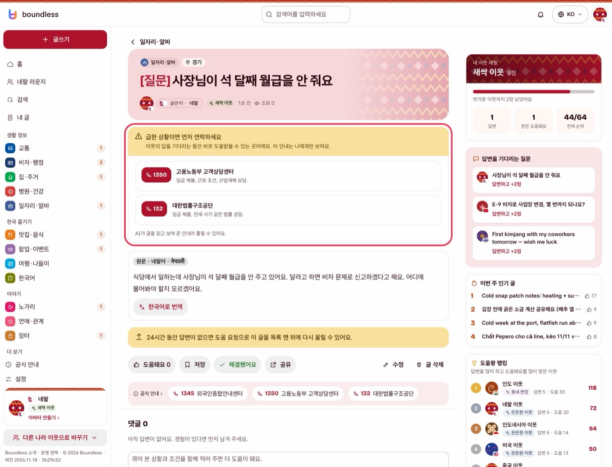

- "사장님이 석 달째 월급을 안 줘요"라는 글을 올리자, AI가 **임금 체불** 상황으로 분류해 고용노동부 1350과 대한법률구조공단 132 카드를 띄웠습니다(빨간 테두리).
- 이 카드는 **글쓴이 본인에게만** 보입니다. 다른 사람은 이 글이 위기로 분류됐는지 알 수 없습니다.
- 분류 유형은 7가지입니다: 자해·자살 위기, 가정폭력·성폭력, 감금·여권 압수·강제 노동, 폭행·위협, 응급 의료, 임금 체불·산업재해, 사기 피해.
- 자해 표현은 AI가 응답하지 않아도 정규식으로 한 번 더 잡습니다(109 자살예방 상담전화 안내).
- 같은 글은 운영 큐의 "AI 우선 확인" 목록에도 올라갑니다(7-3).
- 11월 12일 캡처입니다(디자인 개편 전).

---

## 5. 글쓰기

### 5-1. 어디에 올릴지 고르기

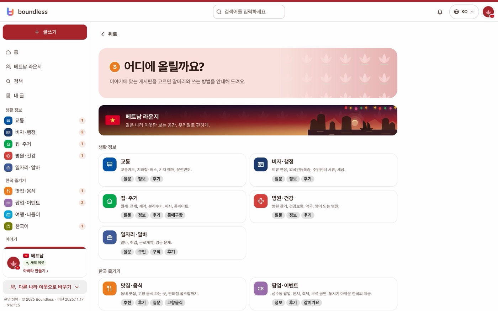

- 1단계에서 라운지나 게시판을 고릅니다. 게시판마다 설명과 말머리(질문, 정보, 후기 등)가 보입니다.

### 5-2. 비슷한 글 안내와 개인정보 경고

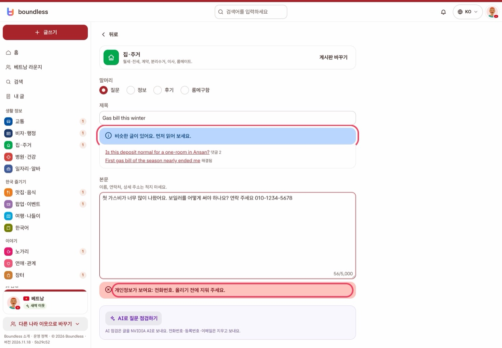

- **비슷한 글이 있어요** (위쪽 빨간 테두리): 제목을 쓰는 동안 같은 게시판의 비슷한 글을 보여 줍니다. 같은 질문이 반복되는 것을 줄입니다.
- **개인정보 경고** (아래쪽 빨간 테두리): 본문에 전화번호를 쓰자 바로 "개인정보가 보여요: 전화번호"라고 알립니다. 외국인등록번호, 전화번호, 이메일, 여권번호를 브라우저에서 바로 찾습니다.
- 쓰던 글은 이 기기에 임시 저장되어, 창을 닫았다 열어도 이어서 쓸 수 있습니다.

### 5-3. AI로 질문 점검하기

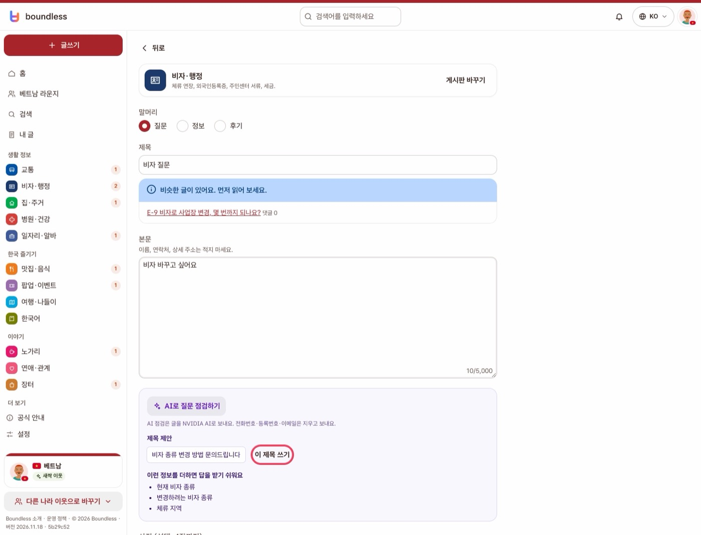

- "비자 질문 / 비자 바꾸고 싶어요"처럼 짧은 글을 점검하자, AI가 구체적인 제목을 제안하고 "현재 비자 종류, 변경하려는 비자 종류, 체류 지역"을 더 적으라고 알려 줬습니다.
- "이 제목 쓰기"를 누르면 제목이 바로 바뀝니다. 다른 게시판이 더 맞으면 그 게시판으로 옮기자고도 제안합니다.
- AI로 보내기 전에 전화번호·등록번호·이메일·여권번호를 지우고 보냅니다. 화면에도 그렇게 안내합니다. 한 사람이 한 시간에 20번까지 쓸 수 있습니다.
- 11월 12일 캡처입니다(디자인 개편 전).

### 5-4. 게시판마다 바뀌는 입력 칸 (장터)

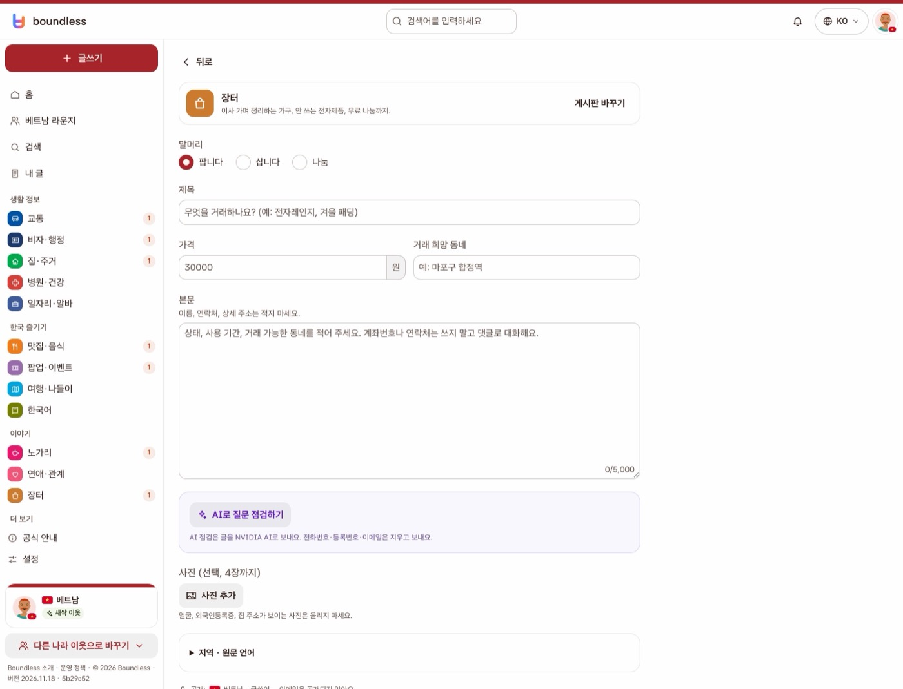

- 장터를 고르면 말머리가 팝니다·삽니다·나눔으로 바뀌고, 가격과 거래 희망 장소 칸이 나옵니다. 올린 뒤에는 거래 상태(판매중·예약중·거래완료, 나눔은 나눔중·나눔완료)를 바꿀 수 있습니다.
- 팝업·이벤트 게시판은 기간과 장소 칸이 나오고, 피드 카드에 "11.14 – 11.21 · 성수동"처럼 보입니다.
- 사진은 브라우저에서 줄여서 올립니다. 쪽지·채팅이 없으므로 거래 대화는 댓글로 하고, 계좌·연락처는 쓰지 않도록 안내합니다.

---

## 6. 프로필, 아바타, 내 글

### 6-1. 설정의 내 프로필 카드

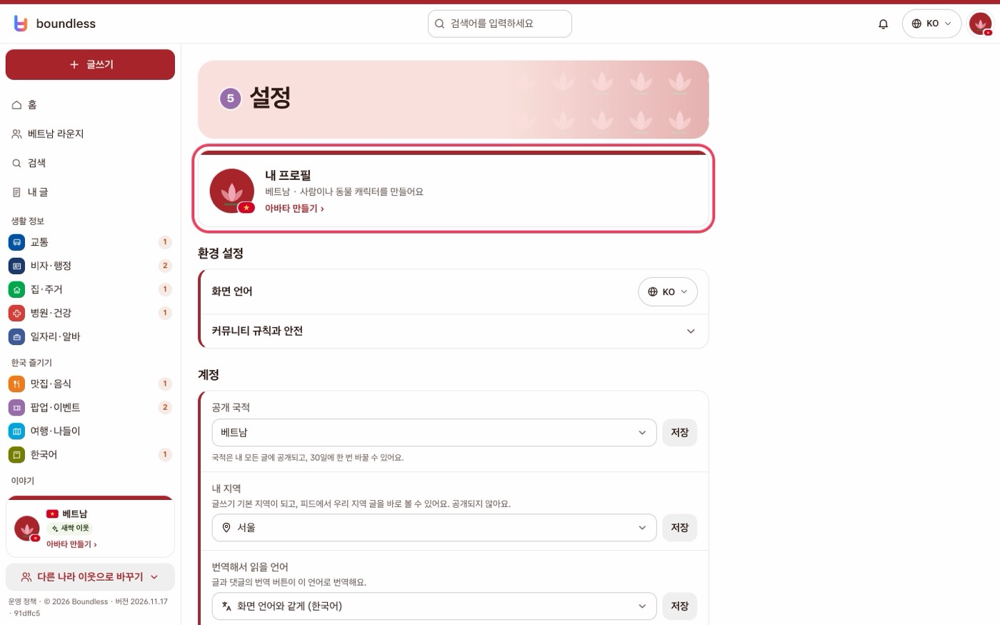

- 설정 맨 위에 내 아바타, 국적, 공개 여부가 보이는 프로필 카드가 있고, 누르면 아바타 화면으로 갑니다(빨간 테두리).
- 아래에는 화면 언어, 공개 국적, 내 지역, 번역해서 읽을 언어, 내 신고 기록, 차단 해제, 탈퇴가 있습니다.

### 6-2. 사람 아바타

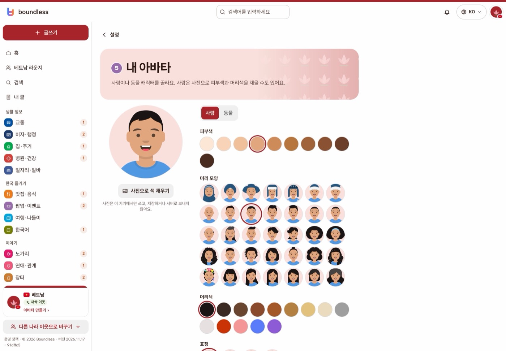

- 피부색 10가지, 머리 모양 35가지(히잡, 터번, 모자 포함), 머리색, 표정, 안경, 수염, 옷 모양과 색을 고릅니다.
- 다국적 커뮤니티라서 피부색과 머리 모양, 종교적 머리 가리개를 넓게 넣었습니다.
- **"내 글과 댓글에도 이 아바타 쓰기"**를 켜야만 다른 사람에게 보입니다. 끄면 국기 아바타만 보입니다.

### 6-3. 동물 아바타

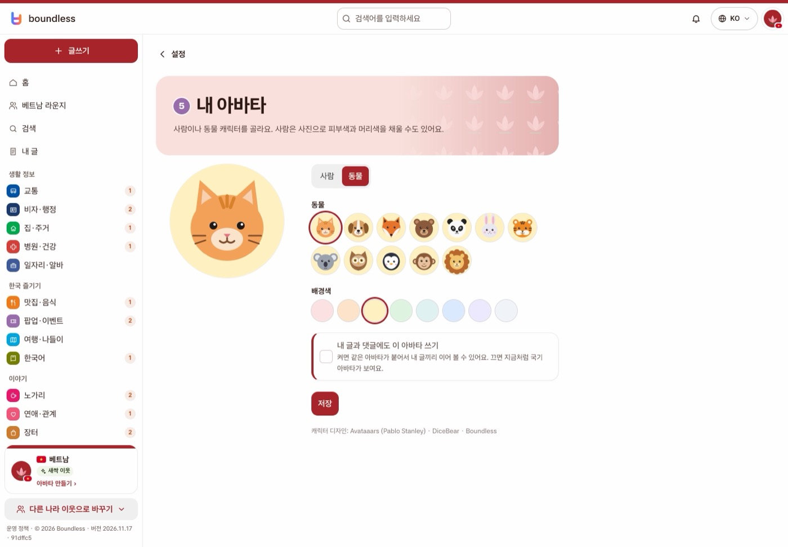

- 얼굴을 드러내고 싶지 않은 사람을 위해 직접 그린 동물 12종과 배경색을 고를 수 있습니다.

### 6-4. 사진으로 피부색·머리색 채우기

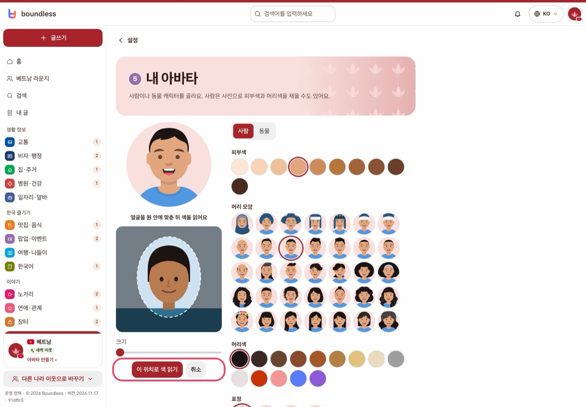

- 사진을 올리고 얼굴을 점선 원 안에 맞춘 뒤 "이 위치로 색 읽기"를 누르면(빨간 테두리), 피부와 머리 부분의 색을 읽어 가장 가까운 색을 골라 줍니다.
- **사진은 서버로 보내지 않습니다.** 브라우저 안의 캔버스에서 색만 읽고 바로 버립니다.
- 캡처에 쓴 얼굴은 실제 사람이 아니라 그림입니다.

### 6-5. 내 글

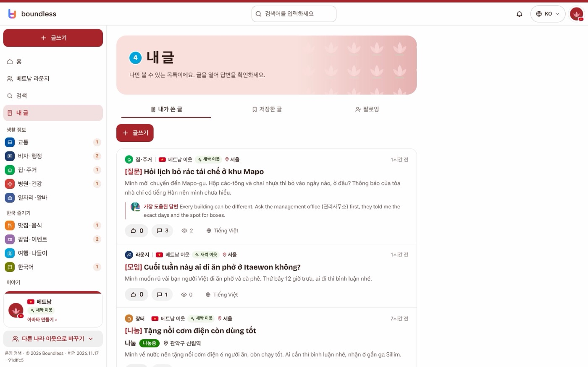

- 내가 쓴 글, 저장한 글, 팔로잉한 이웃의 글을 탭으로 봅니다.
- 레벨 점수: 글 1점, 다른 이웃 글에 답변 2점, "도움돼요"를 받으면 3점입니다. 레벨은 새싹 이웃부터 명예 주민까지 다섯 단계입니다.
- 팔로우는 숫자만 보입니다. 누가 누구를 팔로우하는지는 공개하지 않습니다.

---

## 7. 안전과 운영

### 7-1. 공식 안내

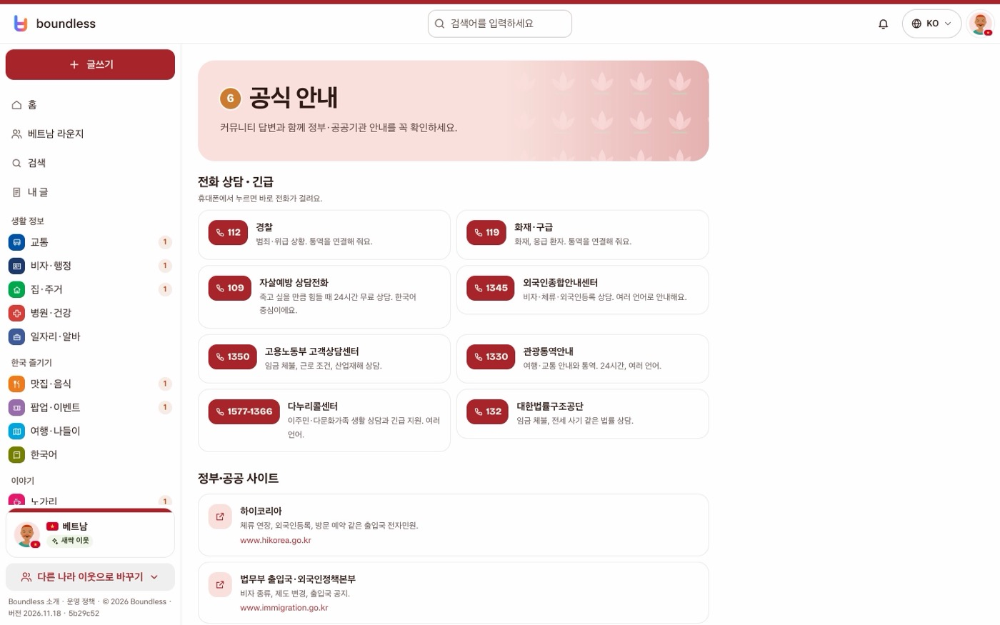

- 경찰 112, 화재·구급 119, 자살예방 109, 외국인종합안내센터 1345, 고용노동부 1350, 관광통역안내 1330, 다누리콜센터 1577-1366, 대한법률구조공단 132와 정부 사이트를 한곳에 모았습니다.
- 번호를 누르면 바로 전화가 걸립니다. 휴대폰 홈에는 "112 · 119 · 공식 안내" 바로가기가 있습니다(34번 화면).

### 7-2. 신고와 차단

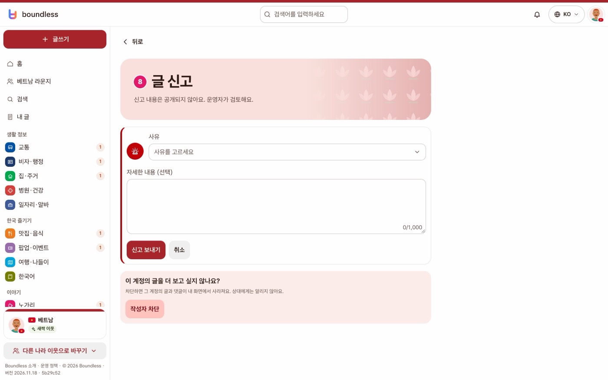

- 사유(개인정보 노출 또는 위협, 혐오·차별 표현, 사기·불법 거래, 광고·도배, 기타)를 골라 신고합니다. 신고 내용은 공개되지 않습니다.
- 같은 화면에서 작성자를 차단하면 그 사람의 글과 댓글이 바로 보이지 않습니다.
- 운영자가 글을 가리면 작성자는 한 번 재심을 요청할 수 있습니다.

### 7-3. 운영 큐

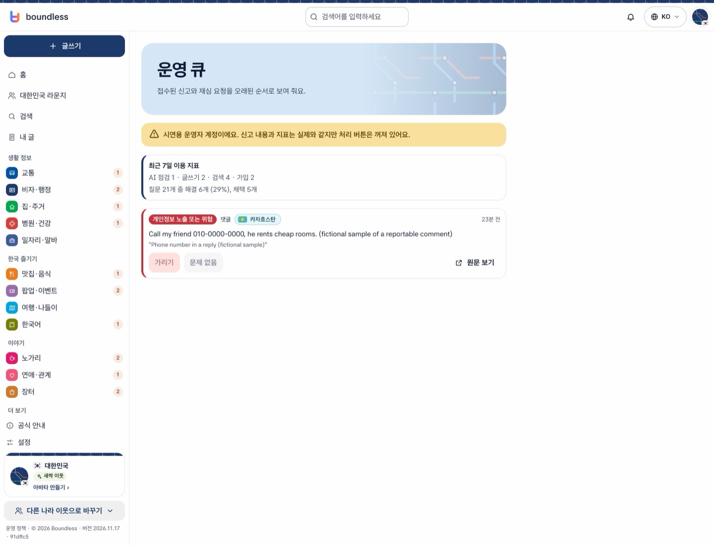

- 맨 위에 최근 7일 이용 지표(검색, 글쓰기, 답변, AI 점검 등의 횟수)와 질문 해결률·채택 수가 있습니다.
- 그 아래에 접수된 신고와 재심 요청이 오래된 순서로 쌓이고, "가리기" 또는 "문제 없음"으로 처리합니다.
- AI가 최근 7일 동안 위기 신호를 읽은 글이 있으면 **AI 우선 확인** 목록이 신고보다 먼저 나오고, 자해 같은 위기 글이 맨 앞에 옵니다. 캡처한 데이터에는 위기 글이 없어 이 목록이 보이지 않습니다.
- 캡처는 체험용 운영자 계정이라 처리 버튼이 꺼져 있습니다(읽기 전용).

---

## 8. 휴대폰 화면

| 홈 | 글 상세 |
| --- | --- |
| 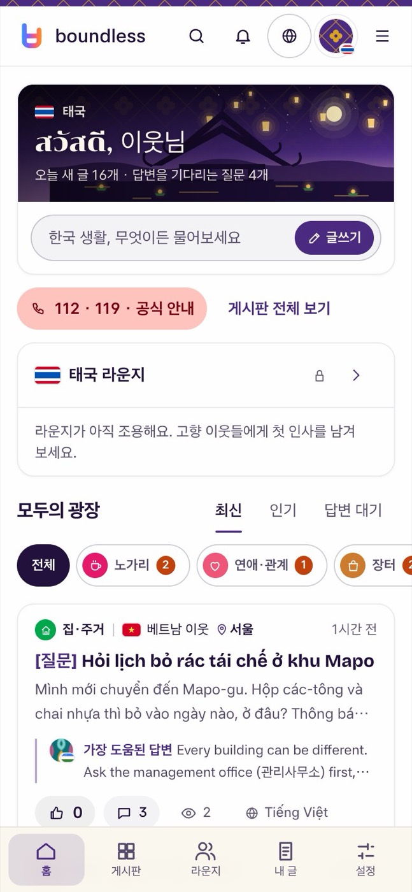 | 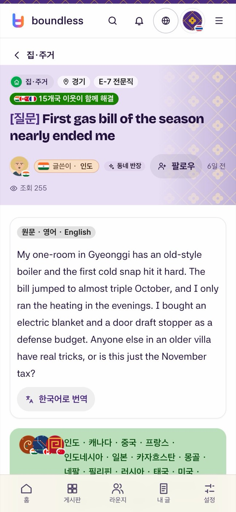 |

- 휴대폰에서는 아래쪽 탭(홈, 게시판, 라운지, 내 글, 설정)으로 이동합니다. 태국 계정이라 러이끄라통 밤 장면과 "สวัสดี" 인사가 보입니다.
- 홈 첫 화면에 빨간 **112 · 119 · 공식 안내** 버튼이 있습니다. 사용자 테스트에서 긴급 번호를 찾는 데 7번을 눌러야 했던 문제를 고쳤습니다.
- 글 상세에서도 원문 언어 표시와 번역 버튼, "15개국 이웃이 함께 해결" 표시가 그대로 나옵니다.
- 320px 폭의 작은 휴대폰까지 한국어·러시아어·필리핀어 화면을 점검해, 가로로 넘치거나 글자가 잘리는 곳을 고쳤습니다.

---

## 디자인 개편 요약 (11월 12일 이후)

| 바뀐 점 | 내용 |
| --- | --- |
| 디자인 시스템 | 모든 화면을 Astryx 컴포넌트(버튼, 입력, 카드, 탭, 대화상자 등)와 Boundless 전용 테마로 옮겼습니다. 나라별 색은 테마 토큰으로 이어져, 어느 화면에서든 내 문화의 색이 유지됩니다. |
| 나라별 장면 | 무늬와 랜드마크 실루엣만 있던 배경을, 조사를 거쳐 하늘·랜드마크·상징 소품이 겹겹이 놓인 16개 장면으로 다시 그렸습니다(1-2). |
| 앱 틀 | 위쪽 검색창과 알림 종, 왼쪽 메뉴(휴대폰은 서랍 메뉴와 하단 탭)로 바꿨습니다. 페이지 제목 옆에는 서울 지하철 노선 배지를 둡니다. |
| 새 기능 | 알림함(3-6), 심사용 체험 가이드(2장) |
| 화면 점검 | 320·390·768·1280px에서 한국어·러시아어·필리핀어 화면을 자동 점검해, 넘침과 잘림을 고쳤습니다. |

---

## AI가 쓰이는 곳 정리

| 기능 | 언제 | 무엇을 하나 | 안전장치 |
| --- | --- | --- | --- |
| 질문 점검 | 글쓰기에서 버튼을 누를 때 | 제목 제안, 빠진 정보, 맞는 게시판 | 개인정보를 지우고 전송, 시간당 20회 |
| 자동 분류 | 글을 올리거나 고칠 때 | 비자 종류, 지역, 위기 신호 | 비자 태그는 글쓴이가 지울 수 있음, 위기 카드는 본인만 봄 |
| 해결 요약 | 해결된 질문을 열 때 | 이웃 답변을 단계별로 정리 | 근거 없는 단계·연락처는 버림, 요약 캐시 |
| 아바타 색 맞추기 | 사진을 고를 때 | 피부색·머리색 추출 | AI 모델이 아니라 브라우저 안의 색 계산, 사진은 전송하지 않음 |
| 샘플 커뮤니티 | 데이터를 만들 때 한 번 | 가상 주민 45명이 2시간 단위 84회 동안 자기 언어로 글·답변·도움돼요를 남김 | 모두 가상 인물·`@example.com` 계정, 실제 서비스 데이터와 분리 |

서비스 안의 AI 모델은 NVIDIA NIM(`nemotron`)을 씁니다. API 키가 없거나 AI가 응답하지 않아도 글쓰기·읽기는 그대로 되고, 자해 위기 신호만 정규식으로 따로 잡습니다. 샘플 커뮤니티는 MiroFish-Ko의 OASIS 소셜 시뮬레이션을 NVIDIA NIM(`glm`)으로 돌려 만들었습니다(`scripts/community/`).
