# Boundless 기능별 화면 안내 (심사용)

한국에 사는 외국인이 모국어로 묻고, 다른 나라 이웃의 경험으로 답을 얻는 커뮤니티입니다. 이 문서는 심사에서 볼 핵심 기능을 화면 단위로 나눠 정리했습니다. 캡처마다 무엇을 보면 되는지 적었고, 빨간 테두리는 그 화면에서 봐야 할 기능입니다.

- 캡처 환경: 로컬 개발 서버, 샘플 데이터(모두 가상 인물·가상 글), 화면 언어 한국어, 데스크톱 1440px · 휴대폰 390px
- AI 기능 캡처(요약, 질문 점검, 비자 태그, 위기 카드)는 미리 만든 결과가 아니라 캡처하면서 NVIDIA NIM을 실제로 호출해 나온 결과입니다.
- 직접 보기: https://boundless-virid.vercel.app → 소개 페이지의 "심사위원 · 체험용 샘플 계정"에서 나라를 고르면 이메일 인증 없이 들어갑니다.

## 한눈에 보기

| # | 화면 | 핵심 기능 | 경로 |
| --- | --- | --- | --- |
| 1~2 | 소개 페이지 | 서비스 소개, 심사용 샘플 계정 | `/` |
| 3~4 | 로그인 | 나라를 고르면 화면 전체가 그 나라 테마로 바뀜 | `/login` |
| 5 | 가입 직후 | 아바타 만들기 첫 단계 (건너뛰기 가능) | `/settings/avatar?welcome=1` |
| 6~7 | 홈 피드 | 모국어 인사, 나라별 라운지, 모두의 광장, 16개 화면 언어 | `/feed` |
| 8~9 | 게시판 · 라운지 | 게시판 12개, 같은 국적만 들어오는 라운지 | `/boards`, `/lounge` |
| 10~11 | 검색 | 원문·번역문 검색, 결과가 없으면 바로 질문 | `/search` |
| 12~17 | 글 상세 | 공식 기관 연결, 번역, AI 비자 태그, 채택 답변, AI 해결 요약, 위기 상담 카드 | `/posts/[id]` |
| 18~20 | 글쓰기 | 게시판 고르기, 비슷한 글 안내, 개인정보 경고, AI 질문 점검 | `/write` |
| 21~25 | 프로필 · 아바타 · 내 글 | 프로필 카드, 사람·동물 아바타, 사진으로 색 맞추기, 레벨 | `/settings`, `/settings/avatar`, `/me` |
| 26~28 | 안전 · 운영 | 공식 안내(긴급 전화), 신고·차단, 운영 큐와 AI 우선 확인 | `/guide`, `/report`, `/admin` |
| 29~30 | 휴대폰 | 하단 탭, 긴급 번호 바로가기, 휴대폰 글 화면 | 같은 경로 |

---

## 1. 첫 화면과 가입

### 1-1. 소개 페이지

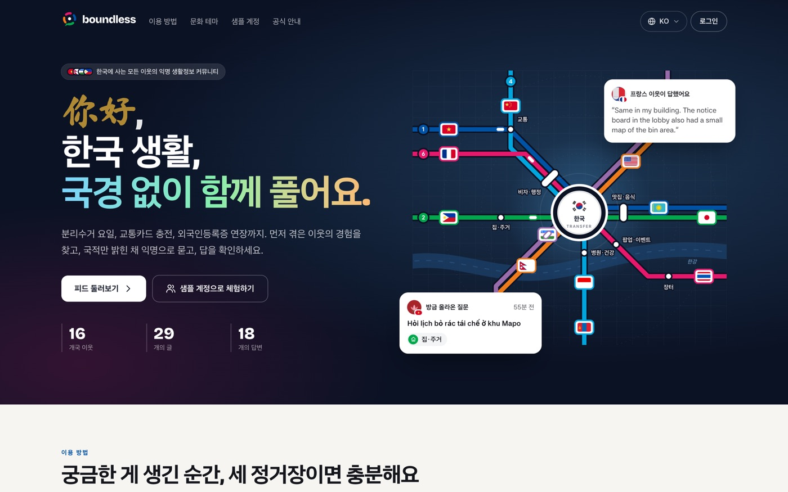

- 서울 지하철 노선도를 모티프로 한 첫 화면입니다. 나라(국기 역)와 생활 주제(교통, 비자, 집, 병원 등)가 노선으로 이어집니다.
- 인사말이 여러 나라 말로 바뀌고, 오른쪽에는 실제 최신 글이 카드로 떠 있습니다.
- 아래 숫자는 지금 DB에 있는 나라 수, 글 수, 답변 수입니다.

### 1-2. 심사위원 · 체험용 샘플 계정

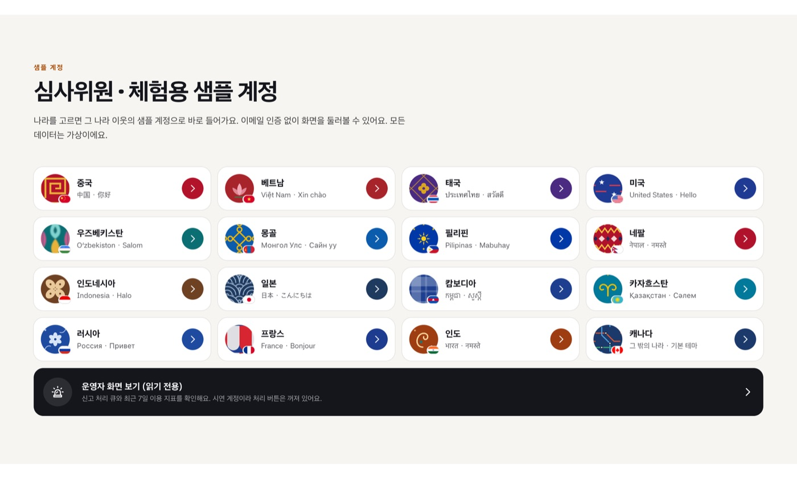

- 나라를 누르면 그 나라 이웃의 샘플 계정으로 바로 들어갑니다. 이메일 인증이 필요 없습니다.
- 맨 아래 "운영자 화면 보기"는 운영 큐를 읽기 전용으로 엽니다(28번 화면).
- 샘플 계정은 모두 `@example.com` 가상 계정이고, 운영 권한은 없습니다.

### 1-3. 나라를 고르면 바뀌는 로그인 화면

| 베트남을 고른 화면 | 일본을 고른 화면 |
| --- | --- |
| 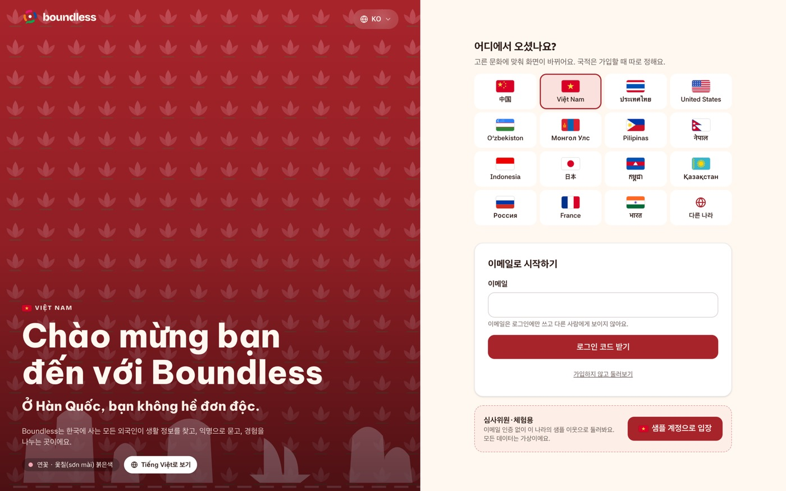 | 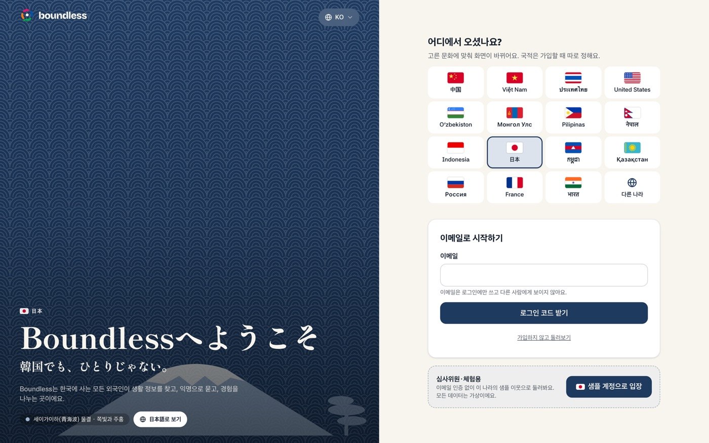 |

- "어디에서 오셨나요?"에서 나라를 누르는 순간, 왼쪽 화면이 그 나라 색, 전통 문양, 랜드마크, 모국어 인사와 서체로 바뀝니다.
- 테마는 16개입니다. 베트남은 연꽃과 옻칠 붉은색, 일본은 세이가이하 물결과 쪽빛입니다. 문화적 논란이 있는 상징(욱일 문양, 크메르루주를 연상시키는 색 등)은 조사해서 뺐습니다.
- 로그인은 이메일 6자리 코드 방식입니다. 비밀번호를 저장하지 않습니다.

### 1-4. 가입 직후: 아바타 만들기 단계

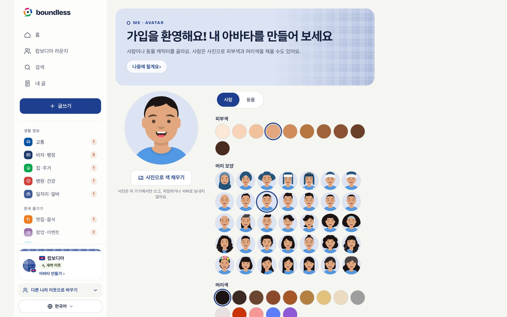

- 가입을 마치면 "가입을 환영해요! 내 아바타를 만들어 보세요" 단계가 먼저 나옵니다.
- "나중에 할게요"를 누르면 바로 원래 가려던 화면으로 갑니다. 강제하지 않습니다.
- 성별이나 나이는 묻지 않습니다. 고르는 것은 생김새뿐입니다.

---

## 2. 홈과 탐색

### 2-1. 홈 피드

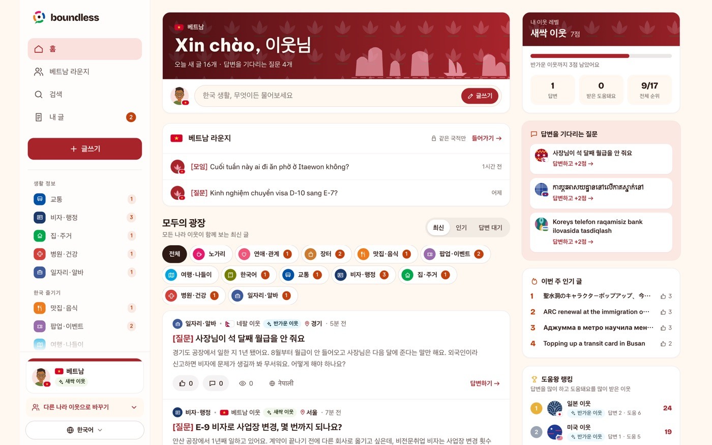

- 맨 위 인사 카드는 내 나라 말로 인사합니다(베트남 계정이면 "Xin chào"). 오늘 새 글 수와 답변을 기다리는 질문 수를 함께 보여 줍니다.
- **베트남 라운지**: 같은 국적만 보고 쓰는 공간의 최신 글입니다.
- **모두의 광장**: 모든 나라가 함께 보는 글입니다. 게시판 칩, 최신·인기·답변 대기 정렬이 있습니다.
- 오른쪽에는 내 이웃 레벨, 답변을 기다리는 질문("답변하고 +2점"), 이번 주 인기 글, 도움왕 랭킹이 있습니다.
- 글마다 국적, 레벨, 지역, 원문 언어가 표시됩니다. 실명이나 이메일은 어디에도 나오지 않습니다.

### 2-2. 화면 언어 16개

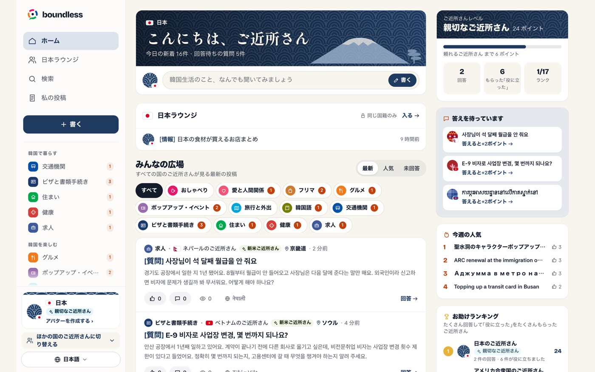

- 같은 홈 화면을 일본 계정으로 본 모습입니다. 메뉴, 버튼, 안내 문구가 모두 일본어입니다.
- 한국어·영어와 14개국 언어(중국어, 베트남어, 태국어, 우즈베크어, 몽골어, 필리핀어, 네팔어, 인도네시아어, 일본어, 크메르어, 카자흐어, 러시아어, 프랑스어, 힌디어)를 지원합니다.
- 언어를 고른 적 없는 기기에서는 국적 언어가 기본입니다.

### 2-3. 게시판

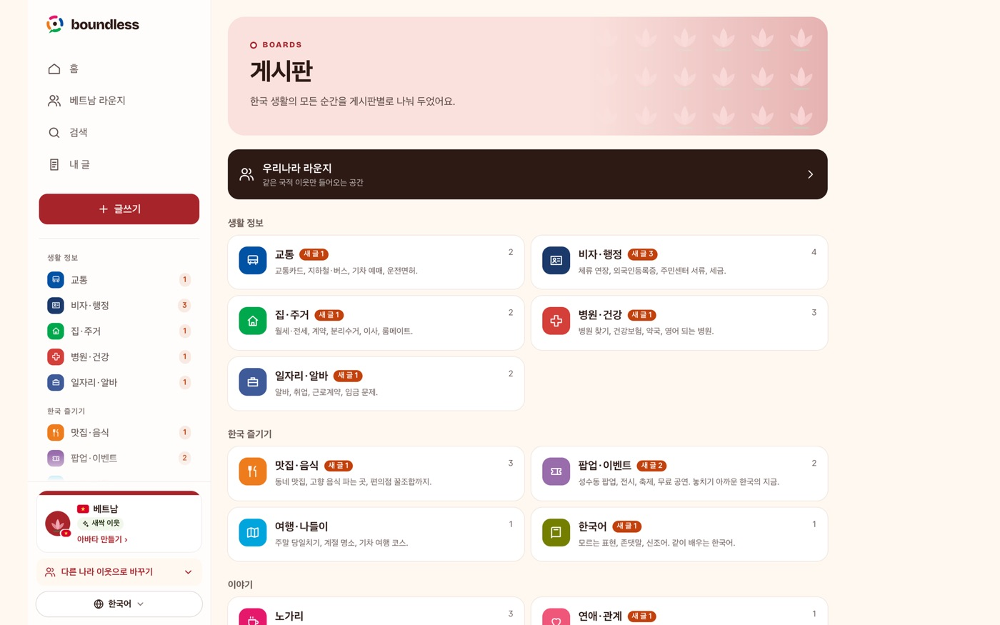

- 생활 정보(교통, 비자·행정, 집·주거, 병원·건강, 일자리·알바), 한국 즐기기(맛집, 팝업·이벤트, 여행, 한국어), 이야기(노가리, 연애, 장터)로 12개 게시판이 있습니다.
- 맨 위 "우리나라 라운지"는 같은 국적 전용 공간입니다.

### 2-4. 나라별 라운지

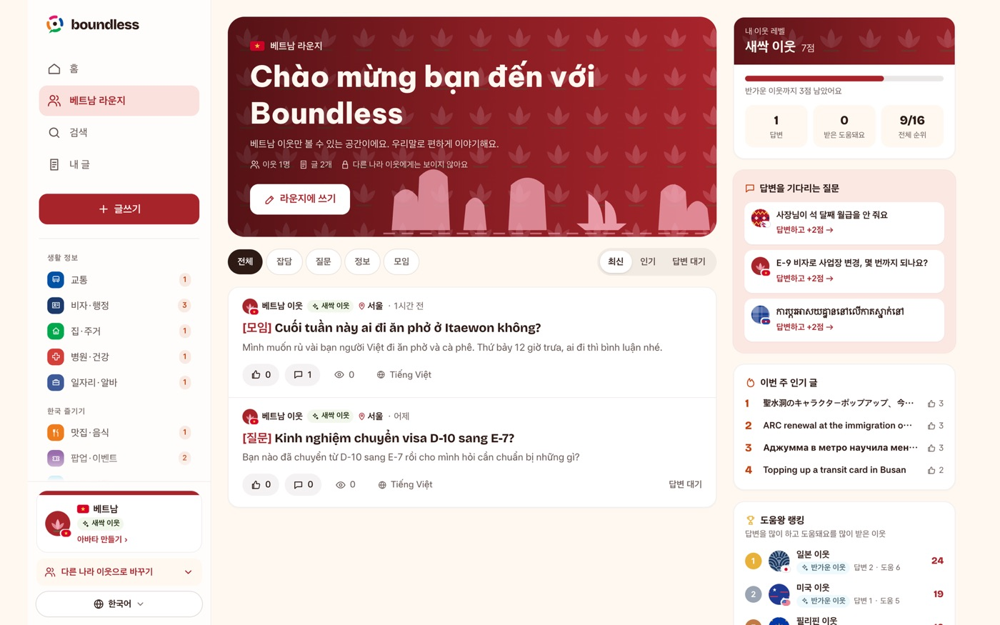

- 같은 국적만 들어오는 공간입니다. 모국어로 편하게 모임, 잡담, 정보를 나눕니다.
- 다른 나라 사람에게는 이 글들이 보이지 않습니다.

### 2-5. 검색

| 결과가 있을 때 | 결과가 없을 때 |
| --- | --- |
| 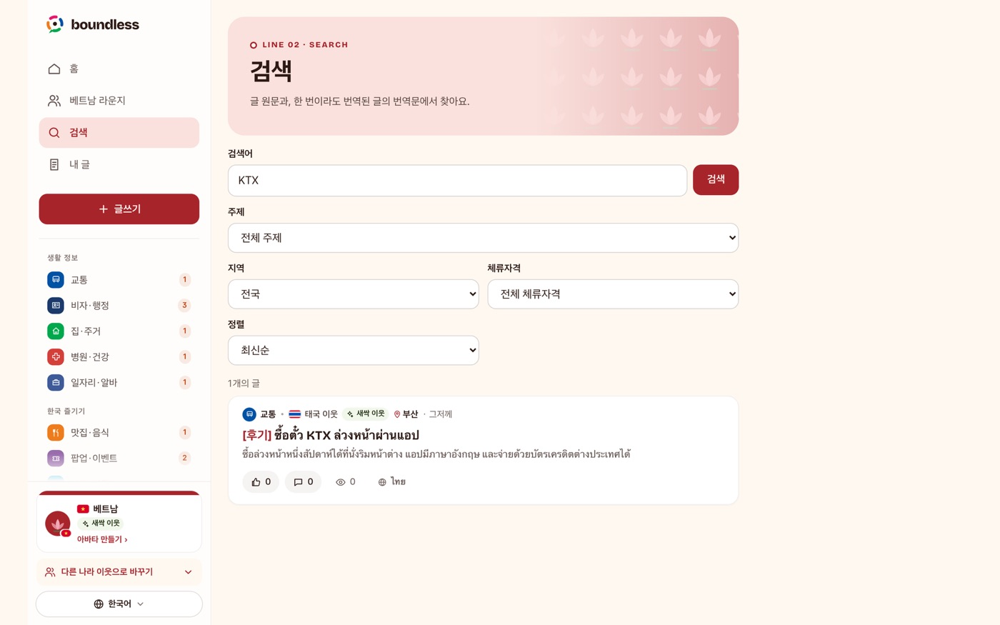 | 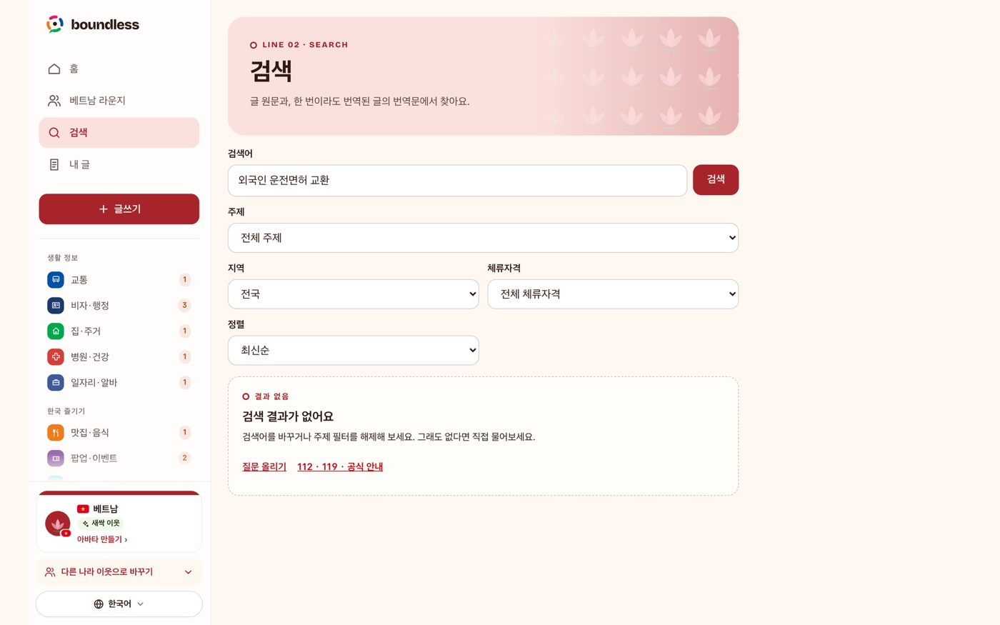 |

- 원문과 번역문을 함께 검색합니다. 주제, 지역, 체류자격, 정렬로 좁힐 수 있습니다.
- 결과가 없으면 "질문 올리기"로 그 검색어를 들고 바로 글쓰기로 갑니다. 급한 사람을 위해 "112 · 119 · 공식 안내" 링크도 함께 나옵니다.

---

## 3. 글 상세 화면

### 3-1. 글 상세와 공식 기관 연결

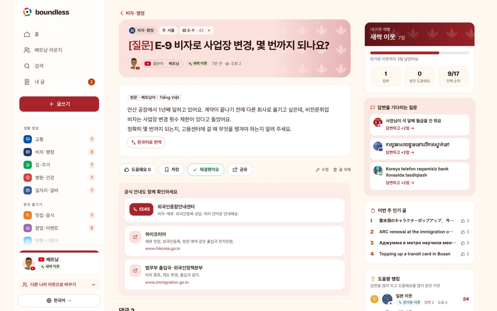

- 글머리에 게시판, 지역, 비자 태그가 있고, 글쓴이는 국적·레벨·익명 호칭으로만 보입니다.
- 본문 아래 **"공식 안내도 함께 확인하세요"**: 비자 글이면 외국인종합안내센터(1345), 하이코리아, 법무부 출입국 사이트가 붙습니다. 경험담만으로 끝나지 않게 공식 정보로 보완합니다.
- 도움돼요, 저장, 해결됨, 공유, 신고 버튼이 한 줄에 있습니다.

### 3-2. 버튼 하나로 번역

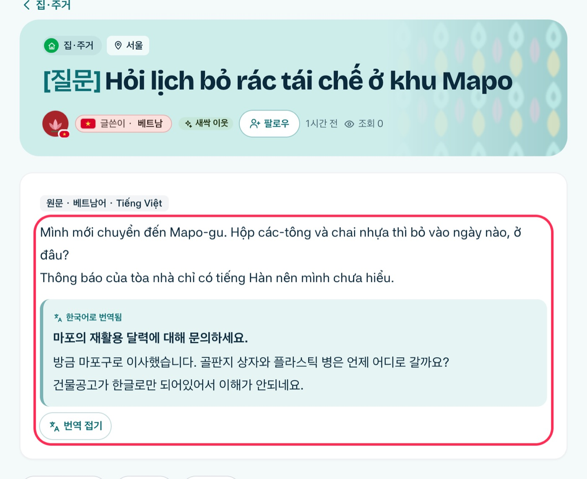

- 베트남어로 쓴 글을 우즈베키스탄 이웃이 한국어 화면에서 본 모습입니다.
- 원문 언어(베트남어)가 표시되고, "한국어로 번역"을 누르면 원문 아래에 번역이 펼쳐집니다(빨간 테두리).
- 번역 결과는 DB에 저장해 다음 사람에게 다시 씁니다.

### 3-3. AI 비자 태그

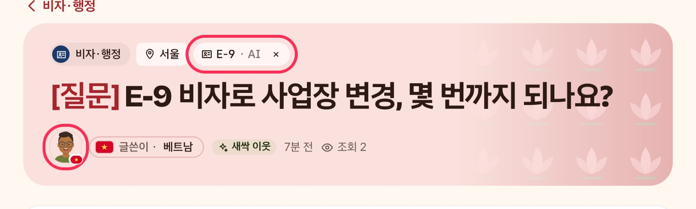

- 글쓴이가 체류자격을 고르지 않았어도, AI가 본문에서 "E-9"을 읽어 **E-9 · AI** 태그를 붙였습니다(빨간 테두리).
- 글쓴이 본인에게만 × 버튼이 보여서, 틀렸으면 바로 지울 수 있습니다.
- 이 태그 덕분에 "E-9" 필터로 검색하면 이 글도 함께 나옵니다.
- 글쓴이 옆의 사람 얼굴은 글쓴이가 공개를 선택한 아바타입니다(22번 화면).

### 3-4. 채택된 답변

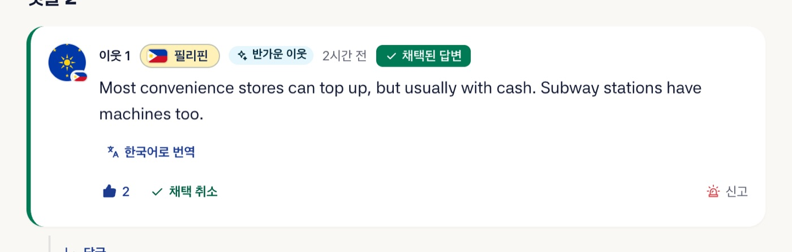

- 질문한 사람이 가장 도움이 된 답변을 "채택"하면 **채택된 답변** 표시가 붙고 맨 위로 올라옵니다.
- 해결된 글에는 "프랑스 · 필리핀, 2개국 이웃이 국경을 넘어 함께 해결했어요"처럼 함께 푼 나라가 표시됩니다(30번 화면).

### 3-5. AI 해결 요약

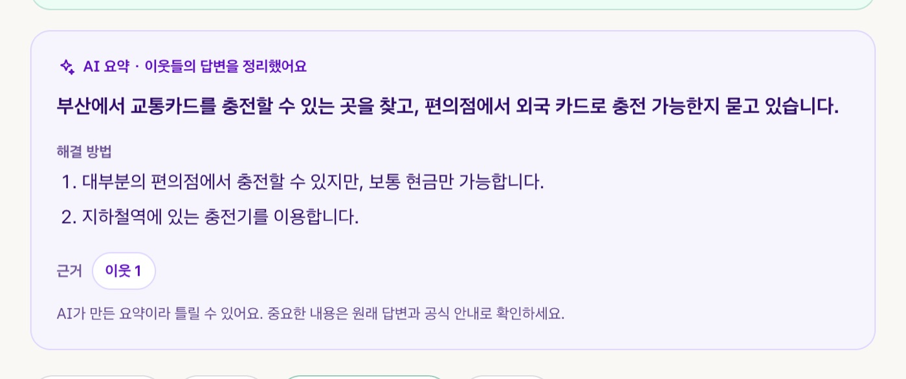

- 해결된 질문에만 나옵니다. 이웃들의 답변을 "상황 → 해결 방법 → 필요한 서류·준비물 → 연락처"로 정리합니다.
- **근거**: 각 내용이 몇 번째 이웃의 답변에서 나왔는지 표시하고, 누르면 그 답변으로 이동합니다. 답변에 근거가 없는 단계는 코드에서 버립니다(AI가 지어낸 내용 차단).
- 연락처도 원래 답변에 실제로 있는 번호만 남깁니다.
- "AI가 만든 요약이라 틀릴 수 있어요" 문구를 항상 붙입니다.

### 3-6. 위기 신호 상담 카드

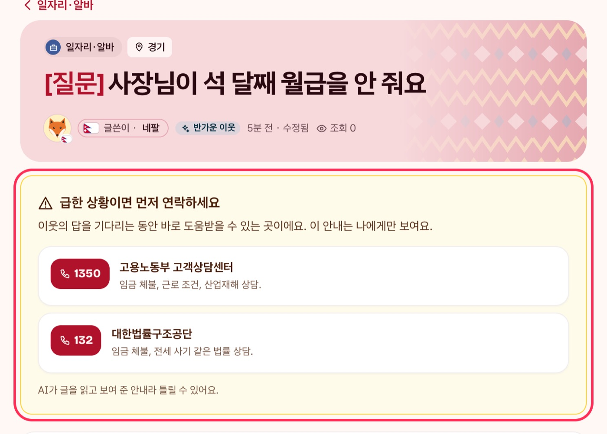

- "사장님이 석 달째 월급을 안 줘요"라는 글을 올리자, AI가 **임금 체불** 상황으로 분류해 고용노동부 1350과 대한법률구조공단 132 카드를 띄웠습니다(빨간 테두리).
- 이 카드는 **글쓴이 본인에게만** 보입니다. 다른 사람은 이 글이 위기로 분류됐는지 알 수 없습니다.
- 분류 유형은 7가지입니다: 자해·자살 위기, 가정폭력·성폭력, 감금·여권 압수·강제 노동, 폭행·위협, 응급 의료, 임금 체불·산업재해, 사기 피해.
- 자해 표현은 AI가 응답하지 않아도 정규식으로 한 번 더 잡습니다(109 자살예방 상담전화 안내).
- 같은 글은 운영 큐의 "AI 우선 확인" 목록에도 올라갑니다(28번 화면).

---

## 4. 글쓰기

### 4-1. 어디에 올릴지 고르기

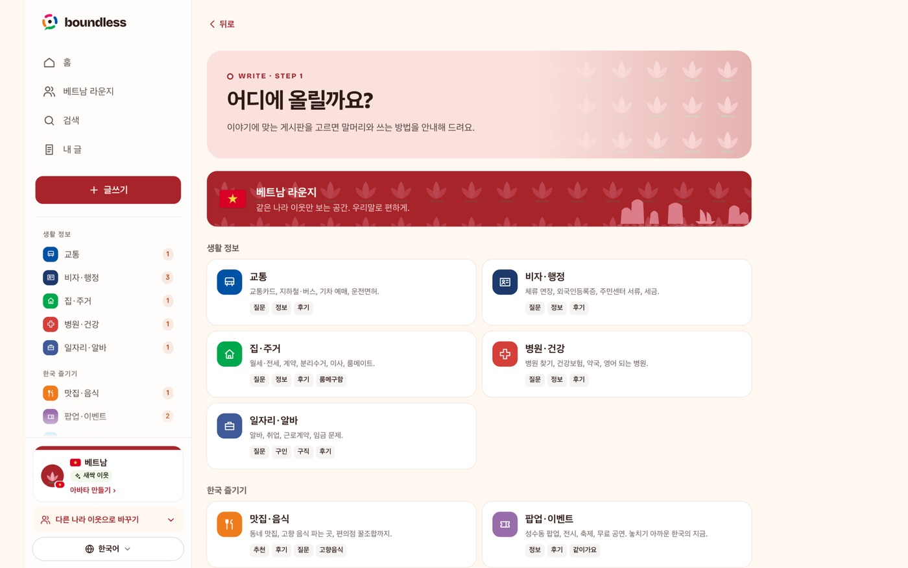

- 1단계에서 라운지나 게시판을 고릅니다. 게시판마다 설명과 말머리(질문, 정보, 후기 등)가 보입니다.

### 4-2. 비슷한 글 안내와 개인정보 경고

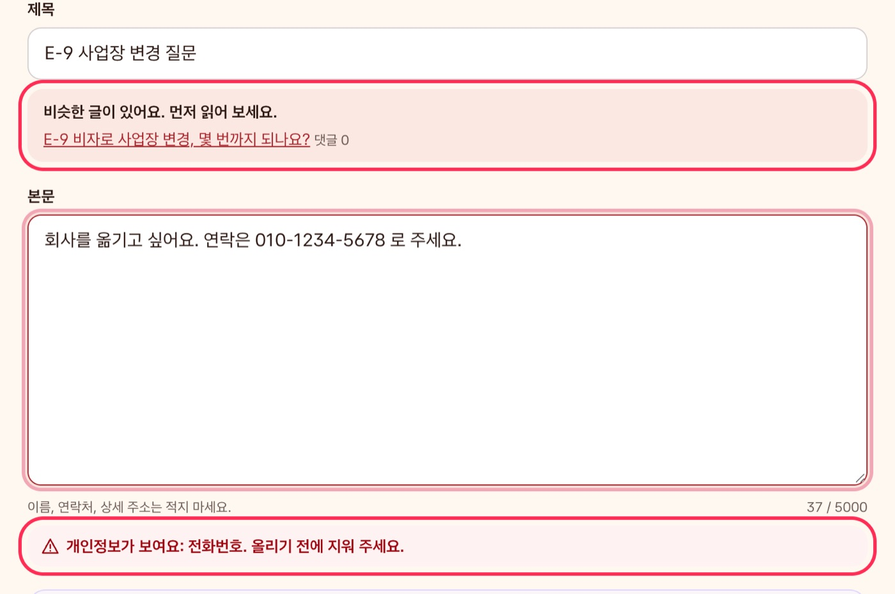

- **비슷한 글이 있어요** (위쪽 빨간 테두리): 제목을 쓰는 동안 같은 게시판의 비슷한 글을 보여 줍니다. 같은 질문이 반복되는 것을 줄입니다.
- **개인정보 경고** (아래쪽 빨간 테두리): 본문에 전화번호를 쓰자 바로 "개인정보가 보여요: 전화번호"라고 알립니다. 외국인등록번호, 전화번호, 이메일, 여권번호를 브라우저에서 바로 찾습니다.

### 4-3. AI로 질문 점검하기

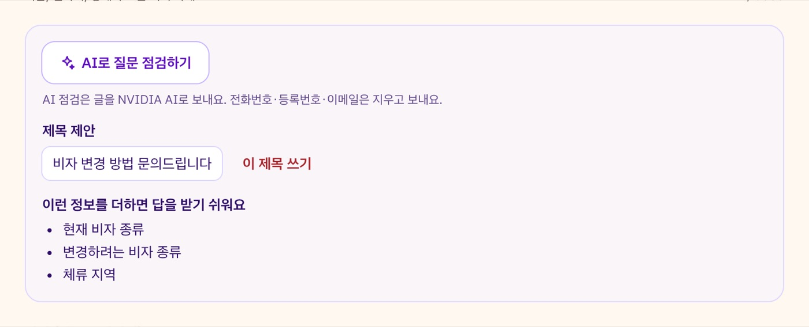

- "비자 질문 / 비자 바꾸고 싶어요"처럼 짧은 글을 점검하자, AI가 구체적인 제목을 제안하고 "현재 비자 종류, 변경하려는 비자 종류, 체류 지역"을 더 적으라고 알려 줬습니다.
- "이 제목 쓰기"를 누르면 제목이 바로 바뀝니다. 다른 게시판이 더 맞으면 그 게시판으로 옮기자고도 제안합니다.
- AI로 보내기 전에 전화번호·등록번호·이메일·여권번호를 지우고 보냅니다. 화면에도 그렇게 안내합니다. 한 사람이 한 시간에 20번까지 쓸 수 있습니다.

---

## 5. 프로필, 아바타, 내 글

### 5-1. 설정의 내 프로필 카드

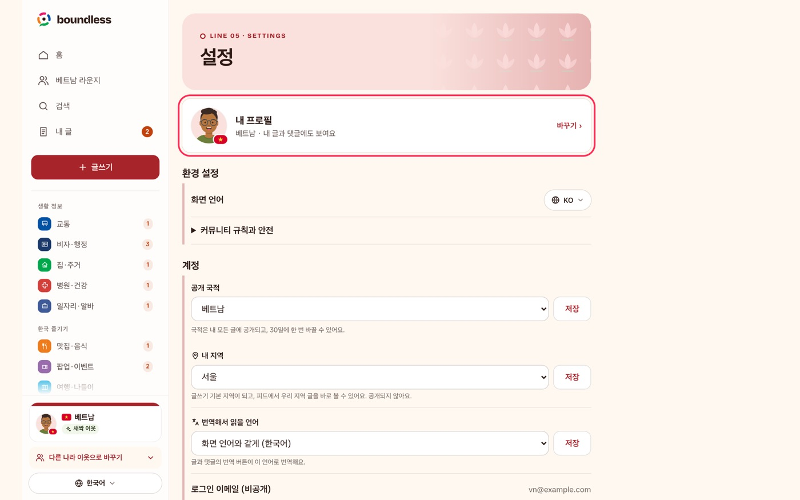

- 설정 맨 위에 내 아바타, 국적, 공개 여부가 보이는 프로필 카드가 있고, 누르면 아바타 화면으로 갑니다(빨간 테두리).
- 아래에는 화면 언어, 공개 국적, 내 지역, 번역해서 읽을 언어, 내 신고 기록, 차단 해제, 탈퇴가 있습니다.

### 5-2. 사람 아바타

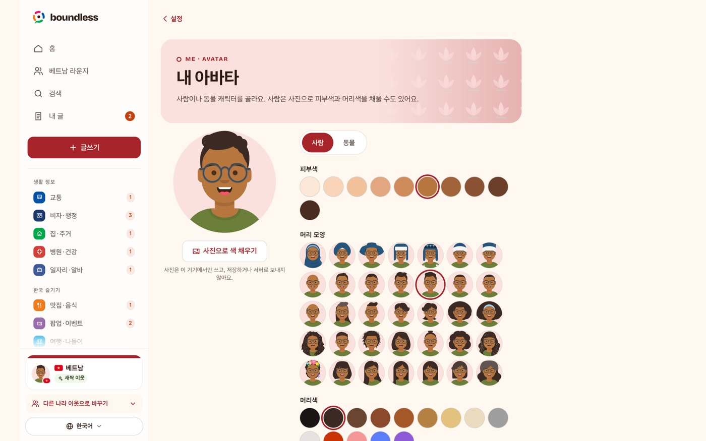

- 피부색 10가지, 머리 모양 35가지(히잡, 터번, 모자 포함), 머리색, 표정, 안경, 수염, 옷 모양과 색을 고릅니다.
- 다국적 커뮤니티라서 피부색과 머리 모양, 종교적 머리 가리개를 넓게 넣었습니다.
- **"내 글과 댓글에도 이 아바타 쓰기"**를 켜야만 다른 사람에게 보입니다. 끄면 지금처럼 국기 아바타만 보입니다.

### 5-3. 동물 아바타

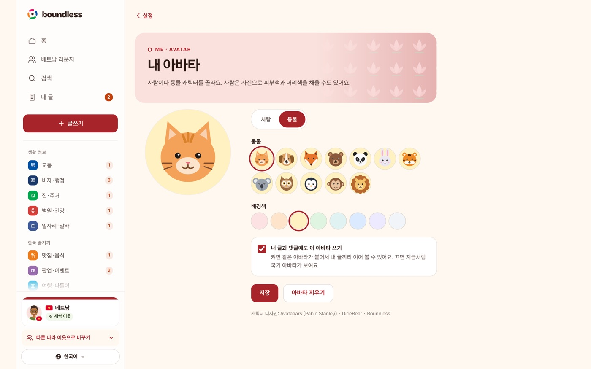

- 얼굴을 드러내고 싶지 않은 사람을 위해 직접 그린 동물 12종과 배경색을 고를 수 있습니다.

### 5-4. 사진으로 피부색·머리색 채우기

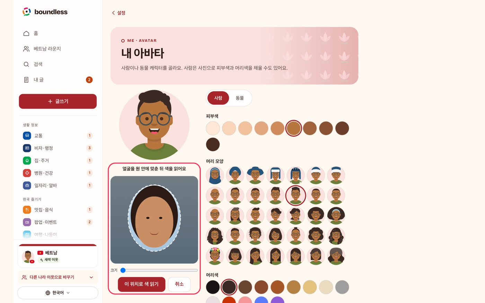

- 사진을 올리고 얼굴을 점선 원 안에 맞춘 뒤 "이 위치로 색 읽기"를 누르면, 피부와 머리 부분의 색을 읽어 가장 가까운 색을 골라 줍니다(빨간 테두리).
- **사진은 서버로 보내지 않습니다.** 브라우저 안의 캔버스에서 색만 읽고 바로 버립니다.
- 캡처에 쓴 얼굴은 실제 사람이 아니라 그림입니다.

### 5-5. 내 글

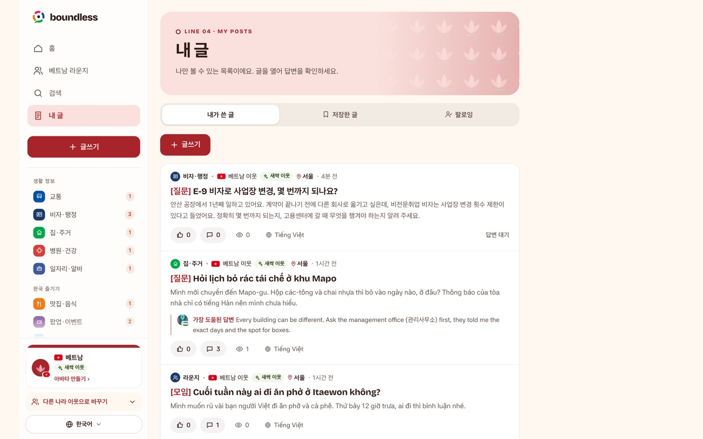

- 내가 쓴 글, 저장한 글, 팔로잉한 이웃의 글을 탭으로 봅니다. 새 답변이 달리면 알림 숫자가 붙습니다.
- 레벨 점수: 글 1점, 다른 이웃 글에 답변 2점, "도움돼요"를 받으면 3점입니다. 레벨은 새싹 이웃부터 명예 주민까지 다섯 단계입니다.
- 팔로우는 숫자만 보입니다. 누가 누구를 팔로우하는지는 공개하지 않습니다.

---

## 6. 안전과 운영

### 6-1. 공식 안내

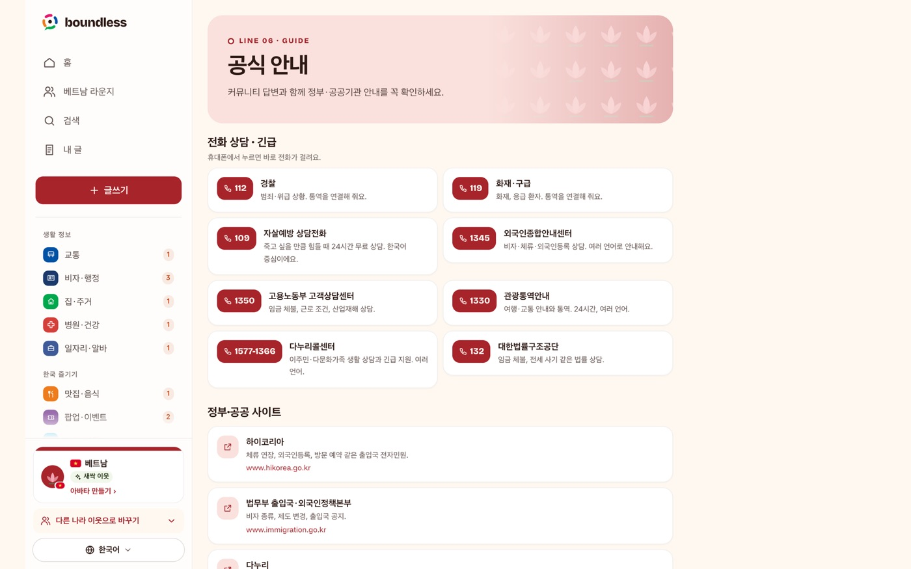

- 경찰 112, 화재·구급 119, 자살예방 109, 외국인종합안내센터 1345, 고용노동부 1350, 관광통역안내 1330, 다누리콜센터 1577-1366, 대한법률구조공단 132와 정부 사이트를 한곳에 모았습니다.
- 번호를 누르면 바로 전화가 걸립니다. 휴대폰 홈에는 "112 · 119 · 공식 안내" 바로가기가 있습니다(29번 화면).

### 6-2. 신고와 차단

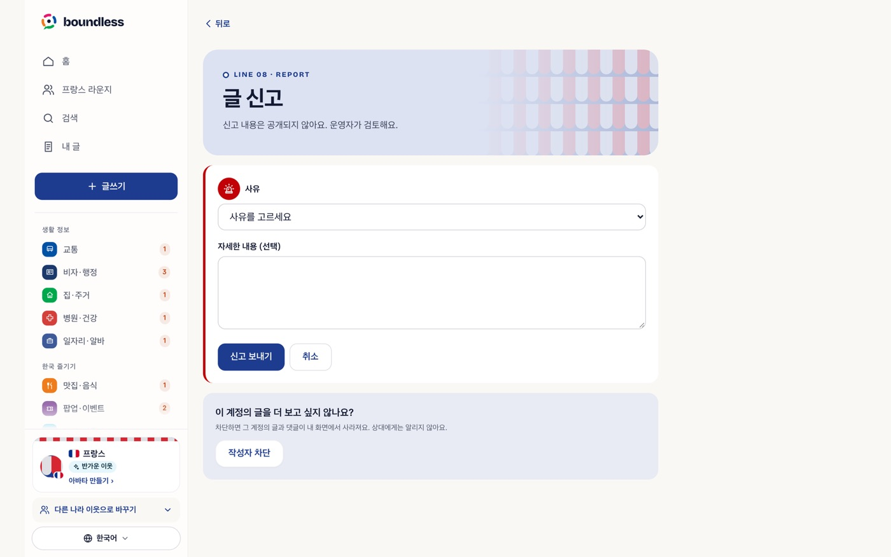

- 사유(개인정보 노출 또는 위협, 혐오·차별 표현, 사기·불법 거래, 광고·도배, 기타)를 골라 신고합니다. 신고 내용은 공개되지 않습니다.
- 같은 화면에서 작성자를 차단하면 그 사람의 글과 댓글이 바로 보이지 않습니다.
- 운영자가 글을 가리면 작성자는 한 번 재심을 요청할 수 있습니다.

### 6-3. 운영 큐와 AI 우선 확인

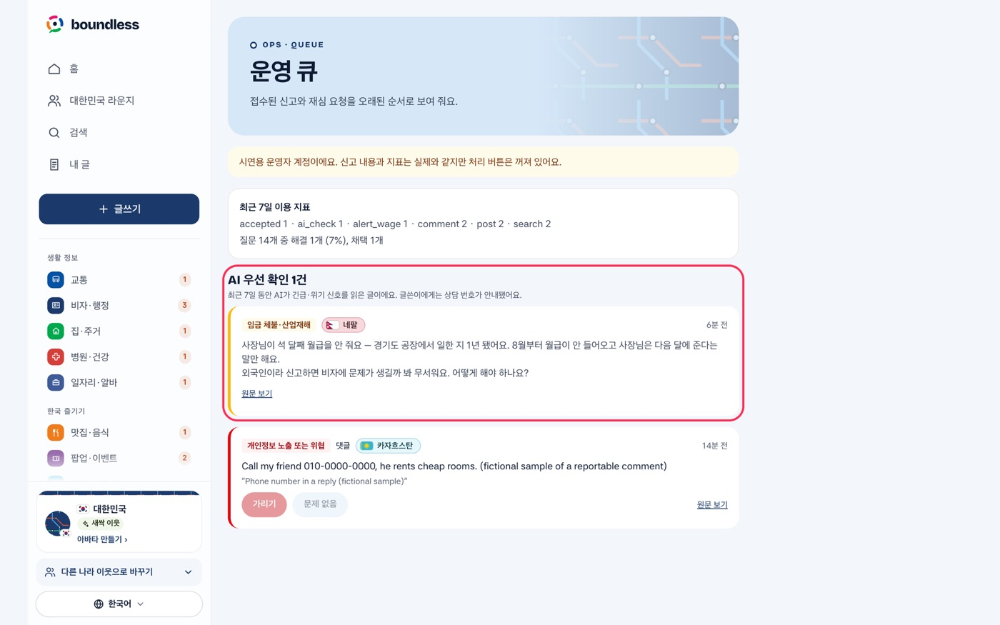

- **AI 우선 확인** (빨간 테두리): 최근 7일 동안 AI가 위기 신호를 읽은 글이 신고 목록보다 먼저 보이고, 자해 같은 위기 글이 맨 앞에 옵니다. 운영자는 상담 번호가 이미 안내된 글부터 살펴볼 수 있습니다.
- 그 아래에 접수된 신고와 재심 요청이 오래된 순서로 쌓이고, "가리기" 또는 "문제 없음"으로 처리합니다.
- 위쪽에는 최근 7일 이용 지표와 질문 해결률이 있습니다.
- 캡처는 체험용 운영자 계정이라 처리 버튼이 꺼져 있습니다(읽기 전용).

---

## 7. 휴대폰 화면

| 홈 | 글 상세 |
| --- | --- |
| 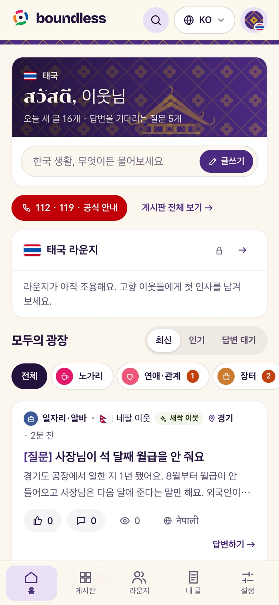 | 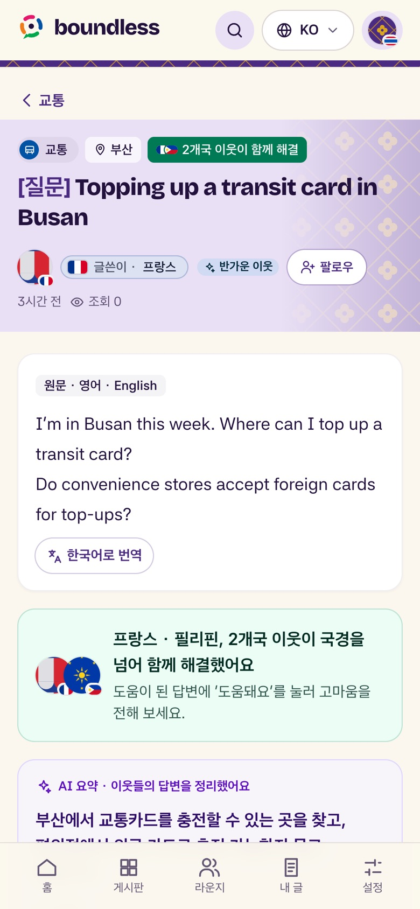 |

- 휴대폰에서는 아래쪽 탭(홈, 게시판, 라운지, 내 글, 설정)으로 이동합니다. 태국 계정이라 태국 테마와 "สวัสดี" 인사가 보입니다.
- 홈 첫 화면에 빨간 **112 · 119 · 공식 안내** 버튼이 있습니다. 사용자 테스트에서 긴급 번호를 찾는 데 7번을 눌러야 했던 문제를 고쳤습니다.
- 글 상세에서도 번역, 함께 해결한 나라 표시, AI 요약이 그대로 나옵니다.

---

## AI가 쓰이는 곳 정리

| 기능 | 언제 | 무엇을 하나 | 안전장치 |
| --- | --- | --- | --- |
| 질문 점검 | 글쓰기에서 버튼을 누를 때 | 제목 제안, 빠진 정보, 맞는 게시판 | 개인정보를 지우고 전송, 시간당 20회 |
| 자동 분류 | 글을 올리거나 고칠 때 | 비자 종류, 지역, 위기 신호 | 비자 태그는 글쓴이가 지울 수 있음, 위기 카드는 본인만 봄 |
| 해결 요약 | 해결된 질문을 열 때 | 이웃 답변을 단계별로 정리 | 근거 없는 단계·연락처는 버림, 요약 캐시 |
| 아바타 색 맞추기 | 사진을 고를 때 | 피부색·머리색 추출 | AI 모델이 아니라 브라우저 안의 색 계산, 사진은 전송하지 않음 |

AI 모델은 NVIDIA NIM(`nemotron`)을 씁니다. API 키가 없거나 AI가 응답하지 않아도 글쓰기·읽기는 그대로 되고, 자해 위기 신호만 정규식으로 따로 잡습니다.
